# Worksheet 5 — Cross-Site Scripting & Client-Side Risks (3 hrs)

> **Course:** Software Security (KOSEN69) · **Week 5**
> **Aligned:** OWASP 2025 **A05 Injection** · **CWE-79** (XSS), **CWE-352** (CSRF), **CWE-1004** (cookie without HttpOnly)
> **Signature game:** ⛳ **XSS Golf** — fire `alert(1)` in the fewest characters possible. Lower payload length = lower score = better. Par for reflected is the `` vector; can you go under par?

> ⚠️ **Ethics note:** Use only the provided `vulnerable_app.py` sandbox and your own Juice Shop container. Stealing real users' cookies or sessions is illegal. All "session theft" steps here target the sandbox cookie `session=abc123` only.

## Part 1 — Student Information

| Name | Student ID | Date | Group |
|------|-----------|------|-------|
| Thiwakorn Boayairuksa | 6631503019 | 11/9/2569 |       |

## Part 2 — Lecture Questions

Answer in 2–4 sentences each.

1. Reflected XSS happens when untrusted input is immediately returned by the server and executed in the victim's browser, while stored XSS is saved by the server and executes later when another user views the stored content. DOM-based XSS occurs entirely in the browser when client-side JavaScript takes untrusted data and inserts it into a dangerous DOM context. In this lab, vulnerable_app.py implements reflected XSS at /hello and stored XSS at /comments.
2. markupsafe.escape converts characters such as < and > into safe HTML entities, so <script> is displayed as text instead of being interpreted as an HTML element. HTML encoding is designed for HTML context, while JavaScript and URL contexts require their own appropriate encoding because the same characters can have different meanings in those contexts.
3. A strict CSP such as script-src 'self' prevents the browser from executing injected inline JavaScript because inline scripts are not allowed by that policy. Therefore, even if an application accidentally fails to encode some output, CSP provides an additional layer of defense against many script-injection attacks.
4. HttpOnly prevents JavaScript from reading the cookie, which helps limit cookie theft through XSS. SameSite controls whether cookies are sent with cross-site requests, helping defend against CSRF, while Secure ensures the cookie is only sent over HTTPS, reducing the risk of network interception.
5. CSRF does not require script injection because the attacker's page can cause the victim's browser to send a state-changing request while the browser automatically attaches applicable cookies. SameSite=Strict prevents the session cookie from being sent with cross-site requests, while the same-origin policy prevents an attacker's page from freely reading responses from another origin.

## Part 3 — Hands-on Lab (150 min)


**Learning goals:** land reflected + stored XSS, abuse a JS-readable cookie, build a CSRF PoC against the comment board, then prove `fixed_app.py` blocks all of it.

**Prerequisites:** Docker + Docker Compose, a browser with DevTools, a text editor. Working dir: `labs/week05-xss-client-side/`.

### Environment setup

```bash
cd labs/week05-xss-client-side
docker compose up            # python:3.12-slim + flask, runs vulnerable_app.py
# vulnerable app -> http://localhost:8080   (service name: xss-lab, port 8080)
```
Optional secondary target (for DOM XSS, which our app does not expose):
```bash
docker run --rm -p 3000:3000 bkimminich/juice-shop       # -> http://localhost:3000
```

**What to submit per task:** the exact **payload**, a **screenshot** of the alert/effect, and a **2–3 sentence mitigation**.

---

**Task 0 — Onboarding (5 min).** Browse `http://localhost:8080/`. Open DevTools → Application → Cookies and confirm `session=abc123` is set with **no HttpOnly / SameSite**. Screenshot it. *Deliverable: screenshot.*
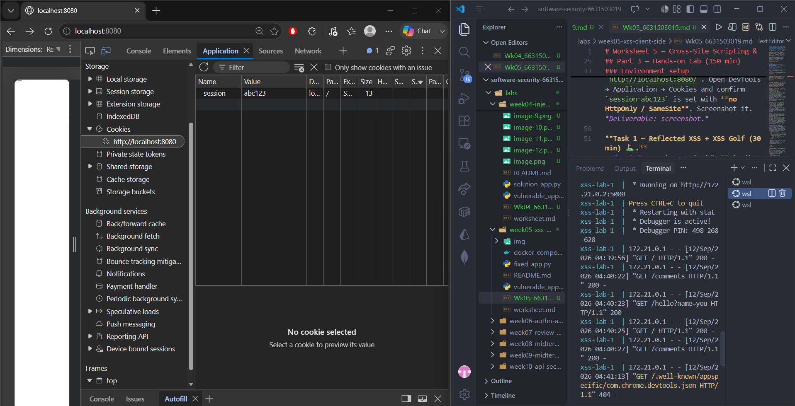
**Task 1 — Reflected XSS + XSS Golf (30 min) ⛳.**
- *Goal:* execute JS via `/hello`, then minimize the payload.
- *Steps:* visit `/hello?name=<script>alert(1)</script>`, then the alternate `/hello?name=` (useful when `<script>` tags specifically are filtered — note it's actually 3 characters longer, not shorter). Record each payload's character count for your golf score.
- *Deliverable:* both payloads + char counts + screenshot of `alert(1)` + your lowest score.
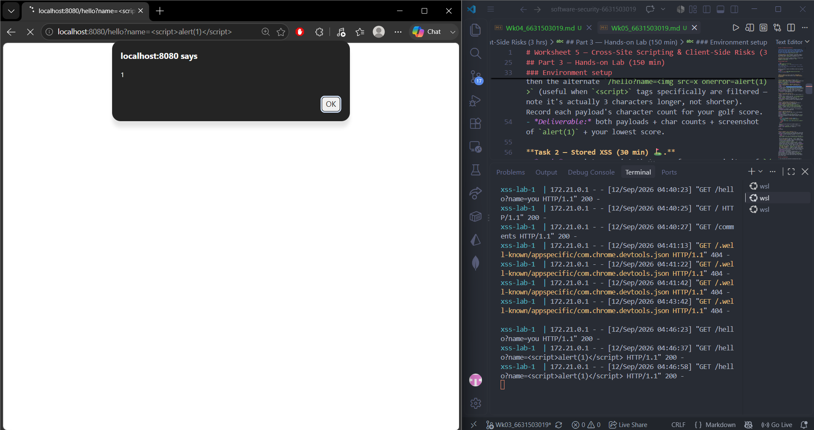
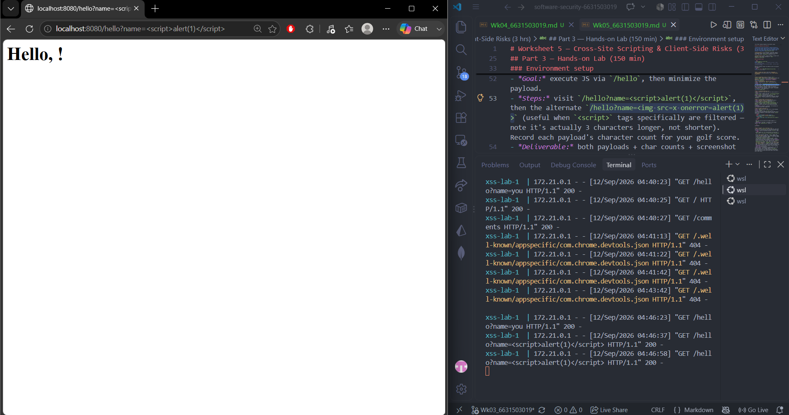
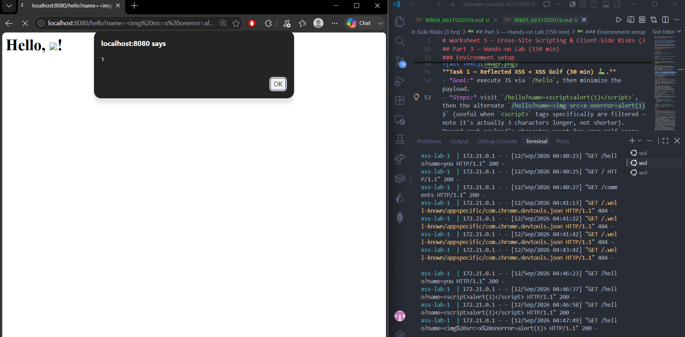
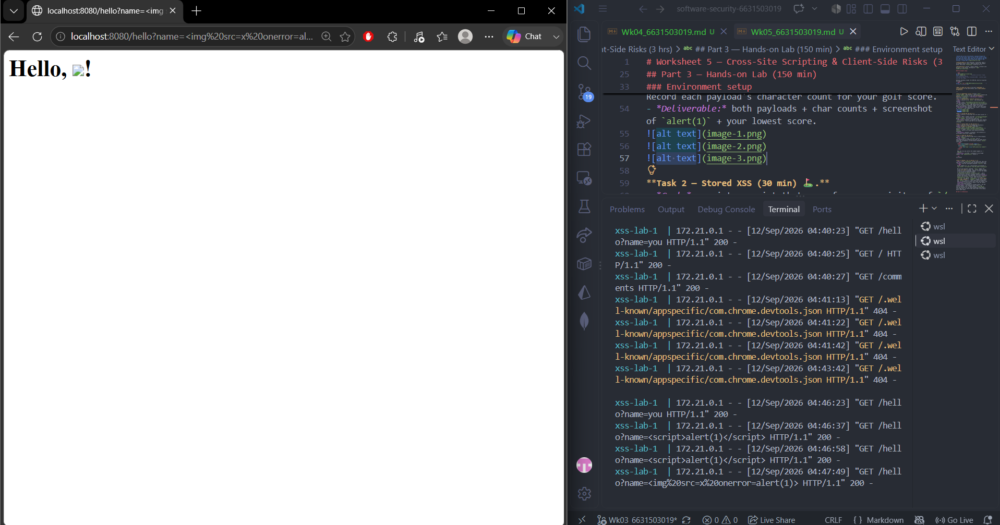

**Task 2 — Stored XSS (30 min) ⛳.**
- *Goal:* persist a script that runs for every visitor of `/comments`.
- *Steps:* POST a comment with body `<script>alert(document.cookie)</script>` (use the form or `curl -d 'body=...'`). Reload `/comments` and watch the cookie pop.
- *Deliverable:* payload + screenshot of the alert showing `session=abc123` + why stored XSS is more dangerous than reflected.
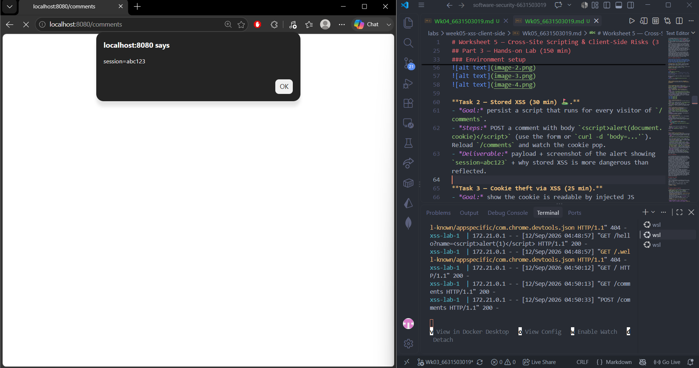//The reason Stored XSS is more dangerous than Reflected XSS is that the payload is stored on the server, allowing other users who visit the same page to trigger it without needing to open a malicious URL directly.
**Task 3 — Cookie theft via XSS (25 min).**
- *Goal:* show the cookie is readable by injected JS because **HttpOnly is missing** (CWE-1004).
- *Steps:* store `<script>new Image().src='http://localhost:8080/hello?name='+document.cookie</script>` (a beacon), or simply ``. Observe the cookie value being exfiltrated/displayed.
- *Deliverable:* payload + screenshot + 2–3 sentences on how HttpOnly would have stopped this.
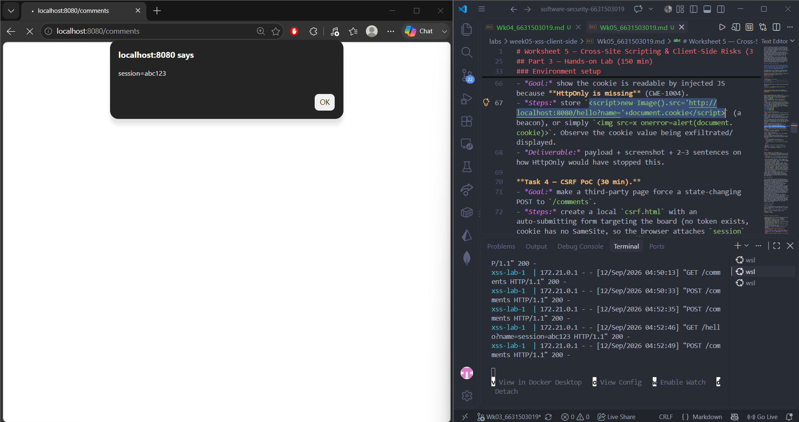
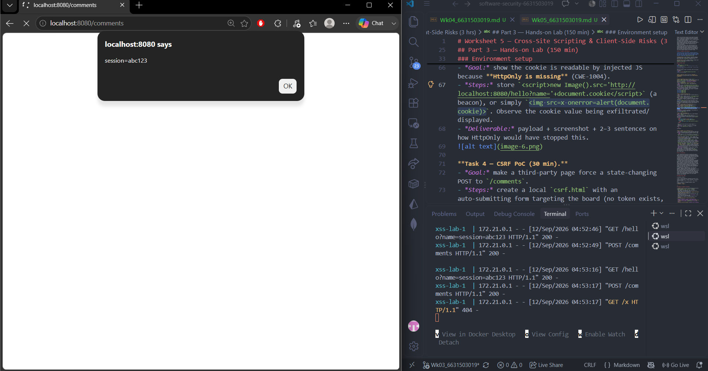
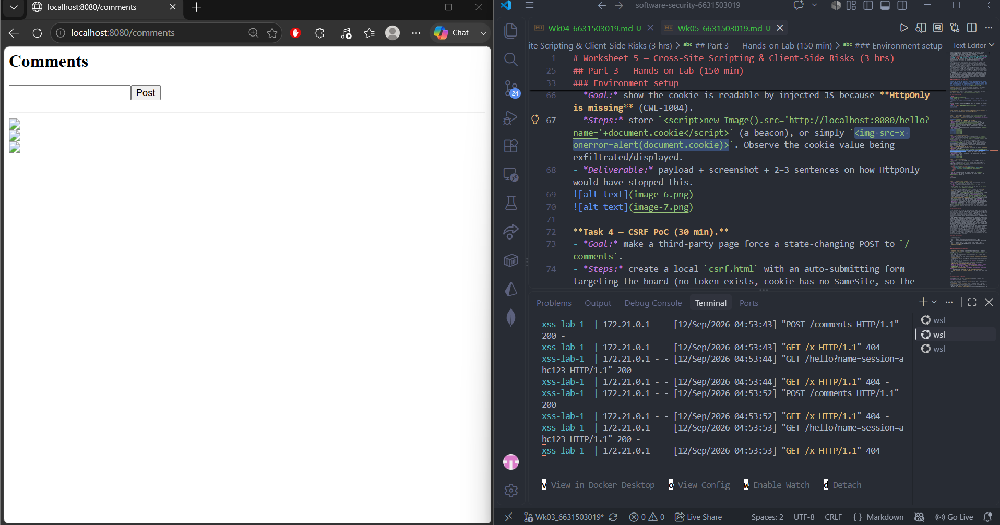//Setting the HttpOnly flag prevents JavaScript from accessing the session cookie through document.cookie. Therefore, even if an XSS vulnerability exists, injected JavaScript cannot directly read the protected cookie.

**Task 4 — CSRF PoC (30 min).**
- *Goal:* make a third-party page force a state-changing POST to `/comments`.
- *Steps:* create a local `csrf.html` with an auto-submitting form targeting the board (no token exists, cookie has no SameSite, so the browser attaches `session` cross-site):
  ```html
  <body onload="document.forms[0].submit()">
    <form action="http://localhost:8080/comments" method="POST">
      <input name="body" value="CSRF posted this comment">
    </form>
  </body>
  ```
  Open the file and confirm the comment appears on `/comments`.
- *Deliverable:* the HTML + screenshot of the forged comment + why `SameSite=Strict` blocks it.
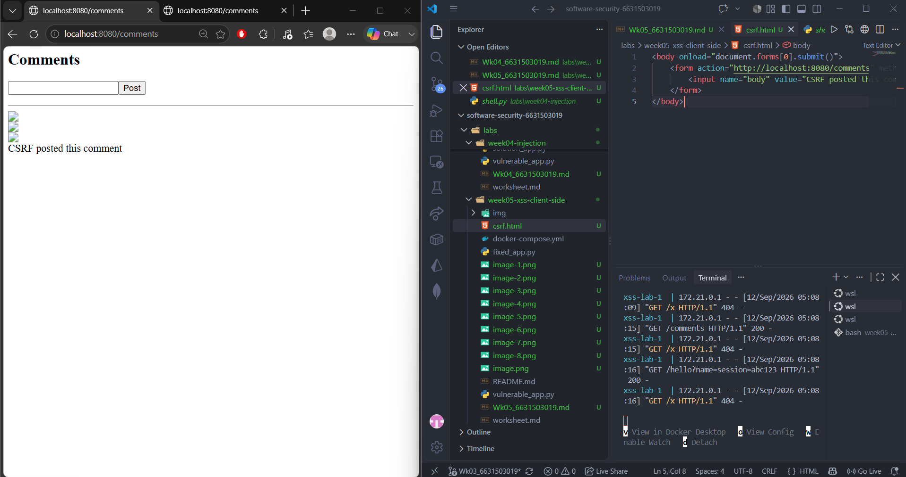//SameSite=Strict prevents the session cookie from being sent with a cross-site request. However, a cookie flag alone is not a complete CSRF defense; the server should also require a CSRF token and validate it before accepting state-changing requests.
```sim
xss-context
```

**Task 5 — Defend / fix it (30 min) 🛡️.**
- *Goal:* prove `fixed_app.py` blocks Tasks 1–3, then show that Task 4's CSRF PoC still gets through and explain why.
- *Steps:* stop the vulnerable container (`Ctrl-C`), then:
  ```bash
  docker compose run --rm --service-ports xss-lab bash -c "pip install --no-cache-dir flask && python fixed_app.py"
  ```
  Re-fire each payload. Expected: `/hello` renders the script **as text** (escape, L21), stored comments render literally (Jinja autoescape, L30–33), a strict CSP header is now present as defense-in-depth (`Content-Security-Policy: script-src 'self'`, L12 — check DevTools → Network → Response Headers; escaping already neutralizes these payloads, so no CSP *violation* fires in the console), and the cookie now has `HttpOnly; SameSite=Strict; Secure` (L42). Then re-run Task 4's `csrf.html` PoC against `fixed_app.py`: it **still posts the forged comment** — `/comments` (L25–28) never checks the `session` cookie or a CSRF token before accepting a POST, so hardening the cookie only stops the browser from *attaching* it cross-site; it doesn't stop the request itself from being processed.
- *Deliverable:* screenshots of escaped output + the CSP response header + the hardened cookie flags + the still-successful Task 4 forgery against `fixed_app.py`, with 2–3 sentences on why cookie hardening alone doesn't close CSRF here (no server-side check tied to the cookie, and no CSRF token).
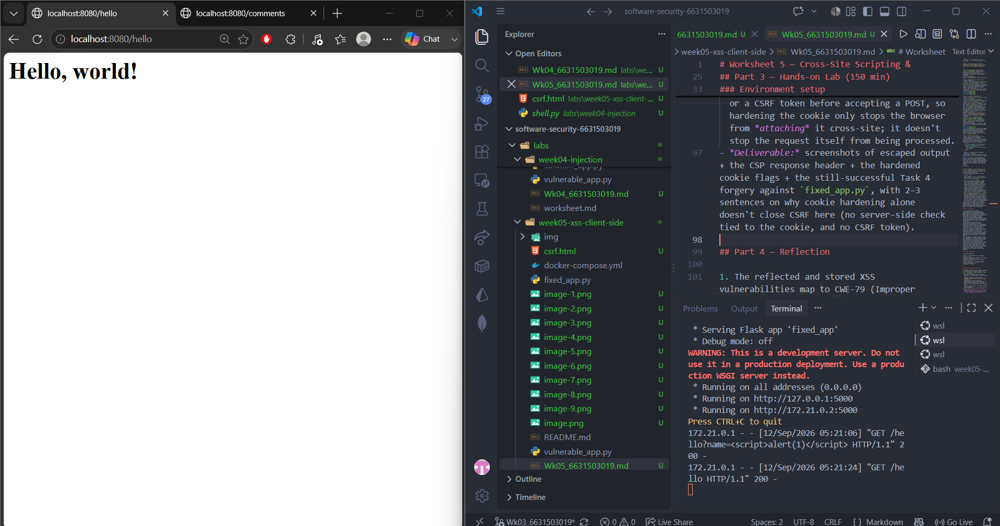
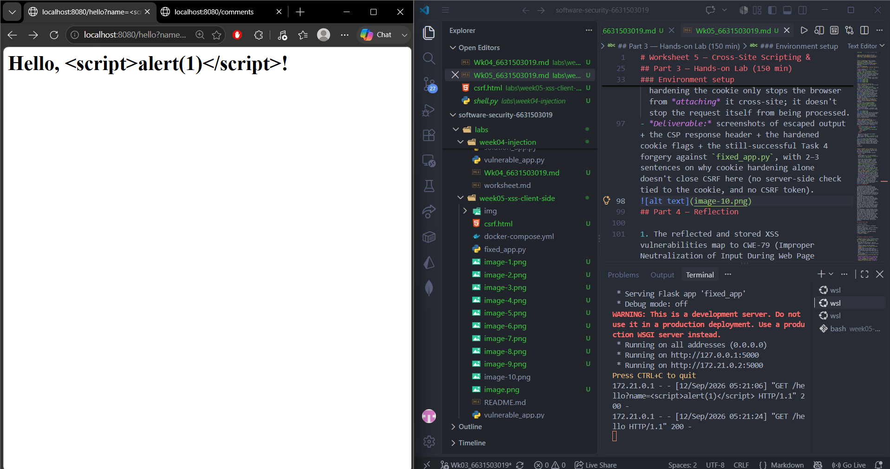
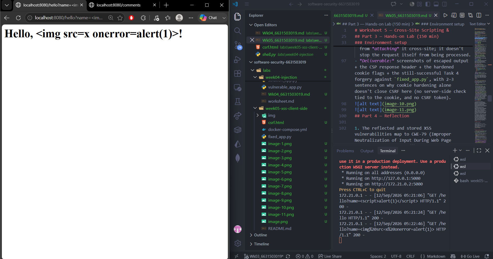
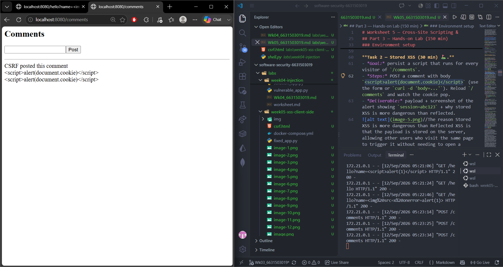
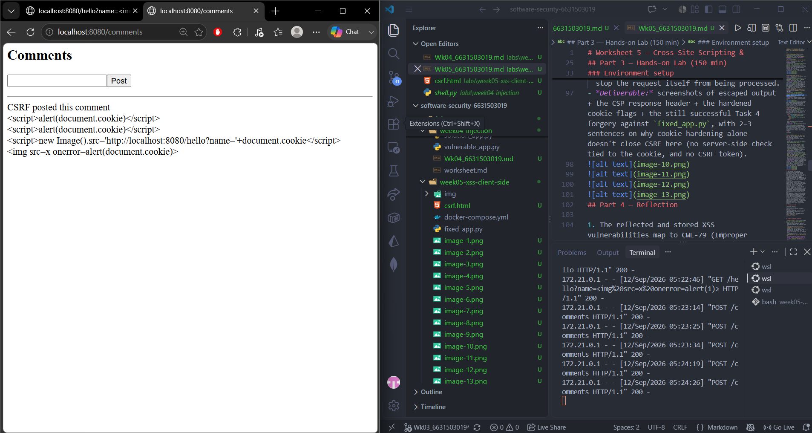//Cookie hardening alone does not completely prevent CSRF because the server does not check whether the request contains a valid CSRF token. SameSite=Strict can prevent the session cookie from being attached to a cross-site request, but the /comments endpoint still accepts the POST because there is no server-side CSRF validation. A CSRF token should be added and verified before accepting state-changing requests.
## Part 4 — Reflection

1. The reflected and stored XSS vulnerabilities map to CWE-79 (Improper Neutralization of Input During Web Page Generation) and are categorized under OWASP A05: Injection in the worksheet's mapping. The CSRF proof of concept maps to CWE-352 (Cross-Site Request Forgery); CSRF is historically associated with OWASP A01 and is treated separately from classic injection even though this worksheet groups it with A05 for the exercise.
2. The 2018 British Airways breach demonstrates the danger of malicious JavaScript being injected into a legitimate website and used to collect sensitive payment information. This is related to the XSS/client-side risks in this lab because JavaScript running in a trusted origin can access or manipulate information available to that page. A strong CSP can provide defense-in-depth by restricting where scripts can come from, while proper output encoding helps prevent untrusted input from becoming executable HTML or JavaScript in the first place.
3. A combination of output encoding, strict CSP, and HttpOnly + SameSite cookies provides the strongest defense-in-depth because each control addresses a different part of the attack chain. Output encoding prevents untrusted data from becoming executable HTML, CSP restricts script execution even if an injection slips through, and cookie flags reduce the impact of XSS and CSRF. Encoding alone is still risky because a mistake in the wrong output context or an unprotected endpoint can leave another injection path available.

## Grading rubric (100)

| Criterion | Points |
|-----------|-------:|
| Part 2 — Lecture questions (conceptual accuracy) | 20 |
| Part 3 — Exploitation + evidence (payloads + screenshots, Tasks 1–4) | 40 |
| Part 3 — Defense (Task 5: fixes proven, lines cited) | 25 |
| Part 4 — Reflection (CWE/OWASP mapping, breach, mitigation) | 15 |
| **Total** | **100** |

---

## Evidence & Integrity (required)

- **Identity proof:** every screenshot/diagram must show a terminal running `printf '%s | %s | ' "$(whoami)" '<YOUR-STUDENT-ID>'; date '+%F %T %Z'` **in the
  same image as the evidence**. When the evidence is a browser page, a DevTools panel or a
  rendered response, put that terminal **beside the browser and capture the whole screen** — a
  cropped window carries nothing that identifies you, and the lab's own output is
  byte-identical for the whole cohort *by design*, so the stamp is the only thing that makes
  the shot yours. Generic or borrowed evidence is not accepted.
- **Personalized flag (if this lab issues one):** ____________________
  *Flags are unique per student — submitting another student's flag is a violation. How to submit: **learn.zcr.ai/submit** (full guide: `SUBMISSION.md` in the repo root).*
- **Explain in your own words** *(graded on your reasoning, not copied text):*
  1. I tested the /hello and /comments endpoints and confirmed that the browser executed the injected code.
  2. fix uses output escaping and Jinja autoescape so injected HTML is displayed as text instead of being executed,  the CSRF issue can still work because the server does not verify a CSRF token, and incorrect encoding for another output context or a newly introduced unsafe endpoint could create another vulnerability.  

---

## 🤖 Audit the AI (required)

AI is a power tool you must **distrust** — you are graded on your *critique*, not the AI's answer.

1. Cookie hardening alone does not completely prevent CSRF because the server does not check whether the request contains a valid CSRF token. SameSite=Strict can prevent the session cookie from being attached to a cross-site request, but the /comments endpoint still accepts the POST because there is no server-side CSRF validation. A CSRF token should be added and verified before accepting state-changing requests.
2. The answer is mostly correct, but it does not provide the actual implementation of the CSRF-token check or explain how the legitimate form obtains the token. It would also be incomplete to claim that SameSite=Strict alone is a complete CSRF defense because the server should still validate a CSRF token for state-changing requests.
3. The correct defense is to generate a CSRF token associated with the user's session, include it in the legitimate /comments form, and verify the submitted token on every state-changing POST. I verified from the lab behavior that fixed_app.py still accepts the csrf.html POST because /comments does not perform this server-side token validation. Therefore, the cookie flags improve security but do not fix the missing CSRF validation.

> Disclose your AI use in the Part 1 table. This task counts toward your **Defense + Reflection** score.

---

## 🧠 Comprehension & Prompt (required)

**A. The vulnerable application takes user-controlled input and puts it directly into HTML or stores it as a comment without safely encoding it. Because the browser interprets the injected HTML as part of the page, an attacker can make JavaScript run in the application's origin and potentially access information such as a JavaScript-readable session cookie.

**B. Review the /comments POST endpoint in this Flask application and provide a secure CSRF fix. Do not rely only on SameSite cookies. Add a server-side CSRF token that is generated for the user's session, embedded in the legitimate comment form, and verified before accepting a POST. Reject missing or invalid tokens. Keep the existing XSS protections, cookie security flags, and application behavior unchanged. Explain exactly why the forged csrf.html request should fail after the fix.
