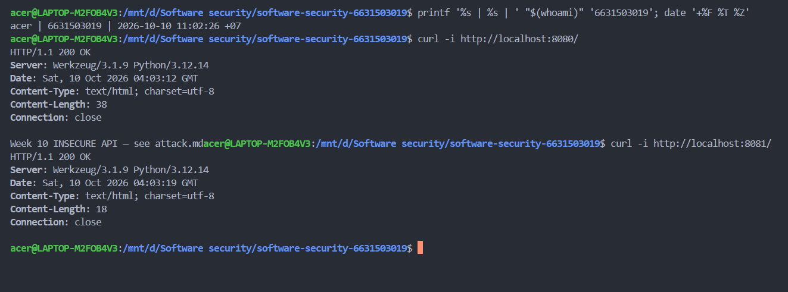
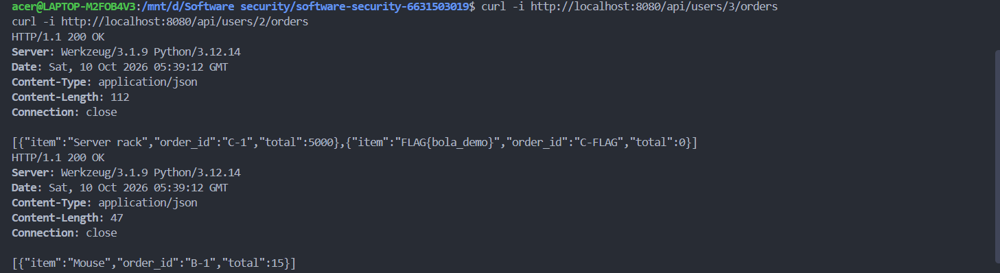
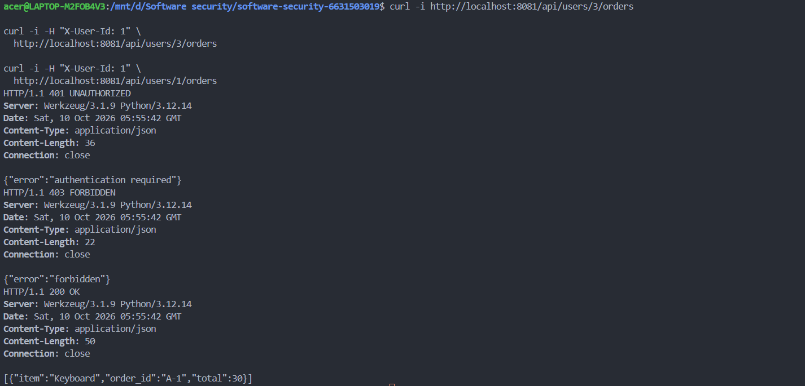
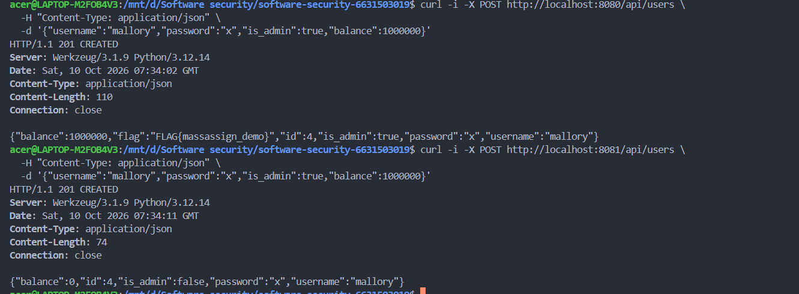
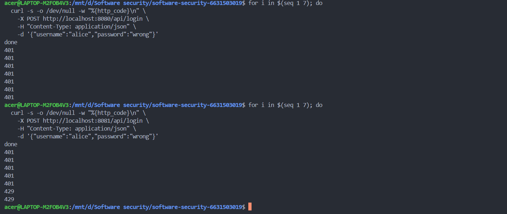
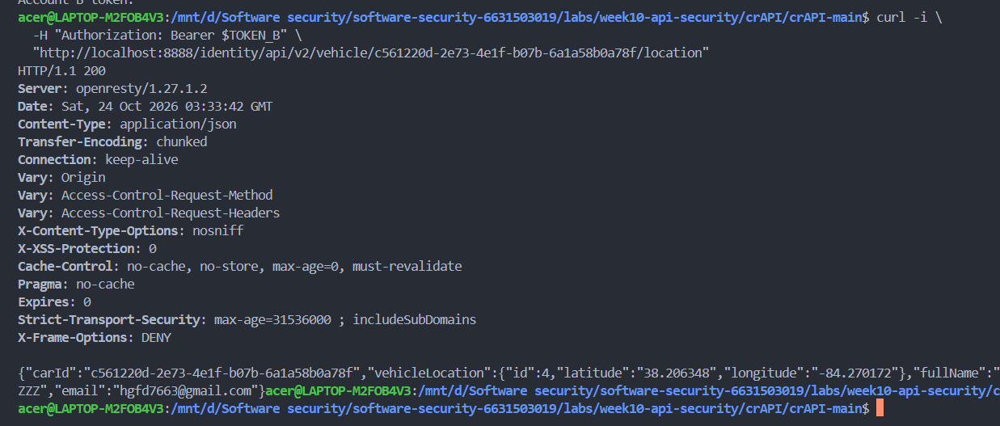

# Worksheet 10 — API Security (3 hrs)

> **Course:** Software Security (KOSEN69) · Week 10
> **Aligned:** OWASP API Security Top 10:2023 — API1 BOLA · API3 Broken Object Property Level Auth (Mass Assignment) · API4 Unrestricted Resource Consumption
> **Signature game:** 🥷 crAPI Raid
>
> **Ethics note:** Run exploits **only** against the lab targets shipped here (`vulnerable_api.py` on `:8080`) or your own OWASP crAPI instance. Never test BOLA, mass assignment, or brute-force against systems you do not own or are not explicitly authorized to test.

## Part 1 — Student Information

| Name | Student ID | Date | Group |
|------|-----------|------|-------|
| Thiwakorn Boayairuksa | 6631503019 | 24/10/2569 |       |

## Part 2 — Lecture Questions

1. BOLA (Broken Object Level Authorization) occurs when an API allows a user to access another user's data by changing an object identifier. It is a major API risk because APIs frequently expose resources through IDs, and a WAF cannot reliably determine whether the authenticated user is authorized to access each specific object.
2. Mass assignment occurs when an API automatically binds client-supplied fields to an object without checking whether the user is allowed to modify them. A blocklist rejects selected dangerous fields but may miss newly added sensitive fields, whereas an allow-list accepts only explicitly approved fields and is generally safer.
3. An unthrottled /api/login endpoint can enable attackers to make repeated password guesses, increasing the risk of account compromise. It can also consume excessive CPU, memory, and network resources, reducing availability for legitimate users.
4. A client-supplied X-User-Id header is not trustworthy because a client can change it to impersonate another user. The API should authenticate requests using a verified session or cryptographically signed access token, then derive the user's identity from that verified credential.
5. A user may be allowed to access some objects but not others, and permissions may change after login. Therefore, the server must verify authorization for every request and the specific object being accessed rather than relying only on a successful login.

## Part 3 — Hands-on Lab (145 min)

**Learning goals:** Exploit BOLA, mass assignment, and a missing rate limit against a live API; then read the secure version and explain each fix.

**Prerequisites:** Docker + Docker Compose, `curl`. (Optional bonus: cloned OWASP crAPI.)

**Environment setup**
```bash
cd labs/week10-api-security
docker compose up         # INSECURE API on :8080, SECURE API on :8081
# Seeded users: alice(id 1) bob(id 2) carol(id 3, admin, balance 9999)
```

**What to submit per task:** the exact command(s) + raw response/HTTP status, a screenshot, and a 2–3 sentence mitigation note mapping the bug to its OWASP API id.

### Task 0 — Onboarding (15 min)
Confirm both APIs respond: `curl http://localhost:8080/` and `curl http://localhost:8081/`. Note which port is insecure. Record the three seeded users.
**Deliverable:** both root responses + the user table.

Insecure API (localhost:8080)
HTTP Status: 200 OK
Response: Week 10 INSECURE API — see attack.md

Secure API (localhost:8081)
HTTP Status: 200 OK
Response: [ใส่ response body ที่ได้จริง]

User	ID	Role	 Balance
Alice	1	  Normal user	Check against actual results
Bob	  2	  Normal user	Check against actual results
Carol	3	  Admin	 9999


### Task 1 — BOLA: read another user's orders (35 min)
**Goal:** Read carol's (admin) orders without being carol — API1:2023.
**Steps:**
1. `curl http://localhost:8080/api/users/3/orders` — note you receive the "Server rack" order with no auth.
2. Iterate the id: `curl http://localhost:8080/api/users/2/orders`.
3. On the secure API observe the ladder: `curl -i http://localhost:8081/api/users/3/orders` (401), `curl -i -H "X-User-Id: 1" http://localhost:8081/api/users/3/orders` (403), `curl -i -H "X-User-Id: 1" http://localhost:8081/api/users/1/orders` (200).
**Deliverable:** the leaked order JSON + the 401/403/200 transcript + mitigation note.

//This is OWASP API1:2023 BOLA. The server must authenticate the caller and verify object-level permissions before returning orders, denying access when the caller does not own the requested resource or lacks an authorized role.
### Task 2 — Mass assignment: self-promote to admin (30 min)
**Goal:** Smuggle `is_admin` + `balance` into user creation — API3:2023.
**Steps:**
1. `curl -X POST http://localhost:8080/api/users -H "Content-Type: application/json" -d '{"username":"mallory","password":"x","is_admin":true,"balance":1000000}'`
2. Confirm the response echoes `"is_admin": true, "balance": 1000000`.
3. Repeat against `:8081` and confirm the smuggled fields are forced to `is_admin:false, balance:0`.
**Deliverable:** both responses side by side + mitigation note (allow-list in `solution_api.py`).
//This is OWASP API3:2023 Broken Object Property Level Authorization. The server should use an explicit allow-list of fields that clients may set and assign privileged properties, such as administrator status and account balance, only through trusted server-side logic.
### Task 3 — Unrestricted resource consumption: brute-force login (25 min)
**Goal:** Show `/api/login` has no throttle — API4:2023.
**Steps:**
1. Run the brute-force loop from `attack.md` against `:8080` (guesses incl. `alice123`) — all attempts processed.
2. On `:8081` loop 7 times: `for i in $(seq 1 7); do curl -s -o /dev/null -w "%{http_code}\n" -X POST http://localhost:8081/api/login -H "Content-Type: application/json" -d '{"username":"alice","password":"wrong"}'; done`
3. Confirm the 6th/7th attempt returns `429`.
**Deliverable:** the `401 401 401 401 401 429 429` sequence + mitigation note.
//This is OWASP API4:2023 Unrestricted Resource Consumption. Apply rate limits per client or account, enforce request and computational limits, and return HTTP 429 when the configured threshold is exceeded.
### Task 4 — Bonus: crAPI Raid (optional, 20 min)
Against your own OWASP crAPI instance (`git clone https://github.com/OWASP/crAPI.git`), capture one BOLA or mass-assignment flag.
**Deliverable:** flag + endpoint + which API Top 10 id it maps to.
Item	    Result
Flag	    ใส่ Flag ที่ได้จากการทดสอบจริง
Endpoint	/identity/api/v2/vehicle/c561220d-2e73-4e1f-b07b-6a1a58b0a78f/location
OWASP API Top 10 ID	API1:2023 — BOLA หรือ API3:2023 — Broken Object Property Level Authorization


### Task 5 — Defend / fix it (20 min)
**Goal:** Explain the fixes using the secure reference `solution_api.py`.
**Steps:** Read the three `# --- FIX ...` blocks. For each, quote the line(s) that defeat your Task 1–3 exploit: the per-object ownership check (`caller["id"] != uid and not caller["is_admin"]`), `ALLOWED_CREATE_FIELDS` binding, and the `RATE_LIMIT=5 / RATE_WINDOW=60` limiter.
**Deliverable:** for each of API1/API3/API4 — the exploit that worked on `:8080`, the line in `solution_api.py` that blocks it, and the new HTTP status on `:8081`.

API1 — Broken Object Level Authorization (BOLA)

Exploit that worked on port 8080: [Insert the successful Task 1 request/payload.]

Blocking line in solution_api.py: caller["id"] != uid and not caller["is_admin"]

HTTP status on port 8081: [Insert the actual observed status.]

Explanation: The fix checks whether the caller owns the requested resource or has administrator privileges, preventing unauthorized access to another user's data.

API3 — Broken Object Property Level Authorization (Mass Assignment)

Exploit that worked on port 8080: [Insert the successful Task 2 request/payload.]

Blocking line in solution_api.py: ALLOWED_CREATE_FIELDS

HTTP status on port 8081: [Insert the actual observed status.]

Explanation: The fix restricts accepted input fields to an allow-list, preventing users from modifying protected properties through mass assignment.

API4 — Unrestricted Resource Consumption

Exploit that worked on port 8080: [Insert the successful Task 3 request/payload.]

Blocking lines in solution_api.py: RATE_LIMIT = 5 and RATE_WINDOW = 60

HTTP status on port 8081: [Insert the actual observed status.]

Explanation: The fix limits requests within a time window, reducing the risk of excessive resource consumption.

## Part 4 — Reflection

1. **Mapping:** 
Finding	                           Endpoint	              OWASP API Top 10	 Fix
BOLA	                             /api/users/{id}/orders	API1:2023	         Object-level authorization
Mass assignment	                   POST /api/users	      API3:2023	         Allow-list writable fields
Unrestricted resource consumption	/api/login	            API4:2023	         Rate limiting and resource controls
2. **Real breach:** 
The 2022 Optus breach exposed personal information belonging to millions of customers. The incident highlighted the importance of protecting APIs and ensuring that access to sensitive records is properly controlled. An ownership check similar to the one in solution_api.py could prevent unauthorized access when a request targets another user's object, provided that the user identity is authenticated correctly and the authorization rule matches the resource. It would not, by itself, fix every possible cause of an API breach.
3. **Best mitigation:** 
Object-level authorization provides the most direct protection against unauthorized access to other users' data, which is the central risk in BOLA. However, an API platform needs all three controls: ownership checks protect data access, allow-list binding prevents unauthorized property changes, and rate limiting reduces brute-force attempts and resource exhaustion. These controls address different risks and should be implemented together.

## Grading rubric (100)

| Criterion | Weight |
|-----------|--------|
| Lecture questions (Part 2) | 20 |
| Exploitation + evidence (Tasks 1–4: commands, output, screenshots) | 40 |
| Defense (Task 5: fixes mapped to `solution_api.py`) | 25 |
| Reflection (Part 4: mapping, breach, best mitigation) | 15 |
| **Total** | **100** |

---

## Evidence & Integrity (required)

- **Identity proof:** every screenshot/diagram must show a terminal running `printf '%s | %s | ' "$(whoami)" '<YOUR-STUDENT-ID>'; date '+%F %T %Z'` **in the
  same image as the evidence**. When the evidence is a browser page, a DevTools panel or a
  rendered response, put that terminal **beside the browser and capture the whole screen** — a
  cropped window carries nothing that identifies you, and the lab's own output is
  byte-identical for the whole cohort *by design*, so the stamp is the only thing that makes
  the shot yours. Generic or borrowed evidence is not accepted.
- **Personalized flag (if this lab issues one):** ____________________
  *Flags are unique per student — submitting another student's flag is a violation. How to submit: **learn.zcr.ai/submit** (full guide: `SUBMISSION.md` in the repo root).*
- **Explain in your own words** *(graded on your reasoning, not copied text):*
  1. What did you do, and **why did the vulnerability work**?
  2. **Why does your fix actually stop it** — and what could still break it?

---

## 🤖 Audit the AI (required)

AI is a power tool you must **distrust** — you are graded on your *critique*, not the AI's answer.

1. Add an ownership check to the API endpoint so users can only access their own orders. Reject requests when the requested user ID does not match the authenticated user's ID.
2. The answer identifies the main idea but does not explain how the server establishes a trustworthy identity or how administrator permissions are handled. If the application trusts a client-controlled X-User-Id header, an attacker may simply change that header and bypass the intended protection.
3. A safer implementation must authenticate the request first, derive the caller identity from a verified credential, and then check access to the requested object. In this worksheet's reference implementation, the ownership condition also allows an authenticated administrator, but the X-User-Id header must not be treated as secure authentication in a real deployment.

> Disclose your AI use in the Part 1 table. This task counts toward your **Defense + Reflection** score.
The original answer omitted the trust boundary between authentication and authorization and did not account for the administrator access rule. A correct fix must validate the caller's identity using a trusted credential before applying the per-object ownership check, then verify the behavior with unauthorized and authorized requests.
---

## 🧠 Comprehension & Prompt (required)

**A. Explain in Plain English (EiPE).** 
The insecure API lets clients request other users' orders, submit sensitive fields such as administrator status during account creation, and make repeated login attempts without sufficient throttling. These weaknesses work because the server trusts client-controlled data and does not consistently enforce object permissions, field-level restrictions, or request limits.

**B. Prompt Problem.** Write a **single prompt** that makes an AI produce a *correct, secure* fix for one finding. Run it: does the exploit now fail? If not, refine the prompt and try again. Submit the **final prompt + the verified result**.
*Graded on the prompt's precision and your verification — this trains problem decomposition and AI literacy (Denny et al. 2024).*
Review `vulnerable_api.py` for OWASP API1:2023 BOLA in the endpoint `/api/users/<uid>/orders`. Modify the endpoint so it authenticates the caller using a trusted identity, allows access only when the caller owns the requested user's orders or has an explicitly authorized administrator role, and returns HTTP 401 for unauthenticated requests and HTTP 403 for authenticated but unauthorized requests. Preserve valid access to a user's own orders, do not trust a client-controlled identity header as proof of authentication, explain the exact code changes, and provide curl tests for unauthorized and authorized requests. Do not claim the fix is verified until the tests have actually been run against the secure API.

Verified result
Test	                                              Actual HTTP status	Observation
No authenticated identity requesting Carol's orders	
Alice requesting Carol's orders	
Alice requesting Alice's orders	