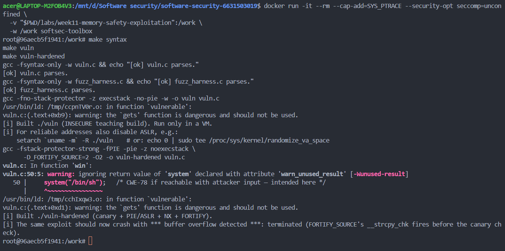
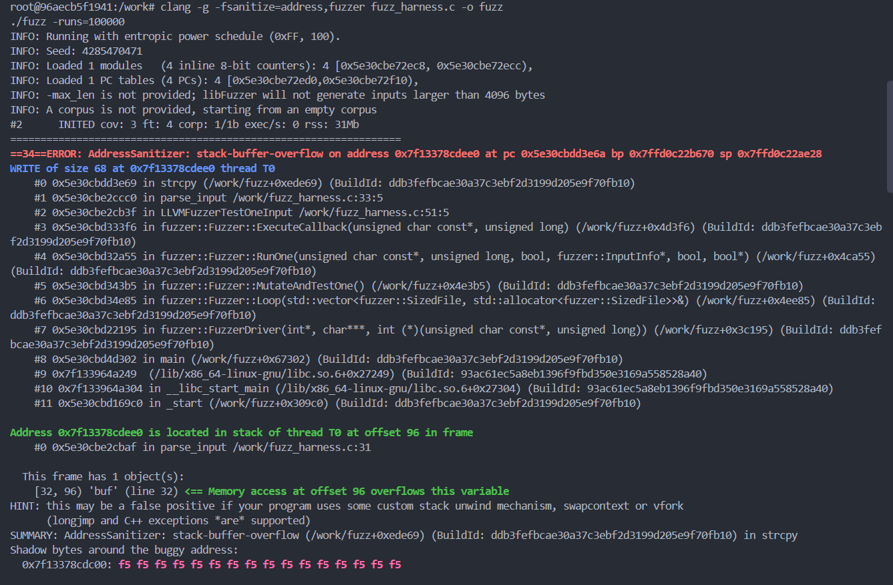
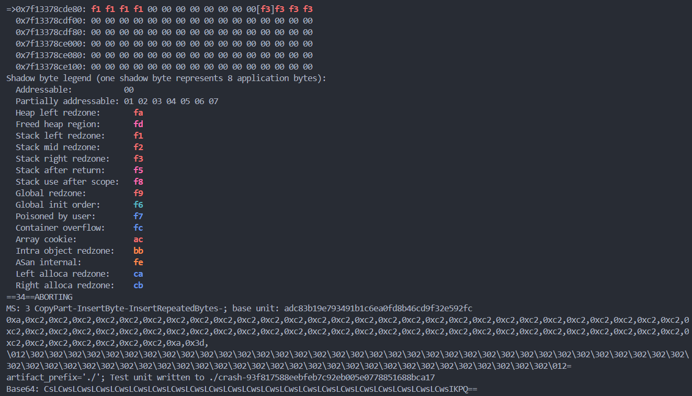
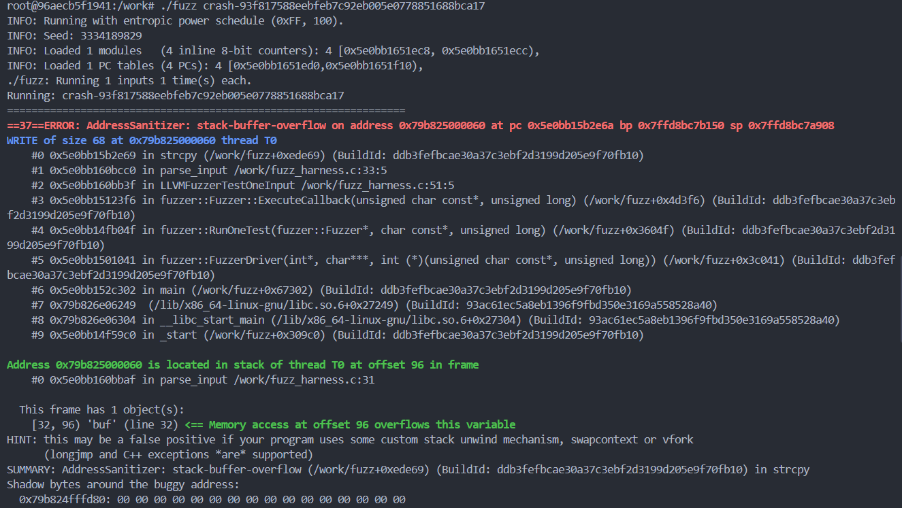
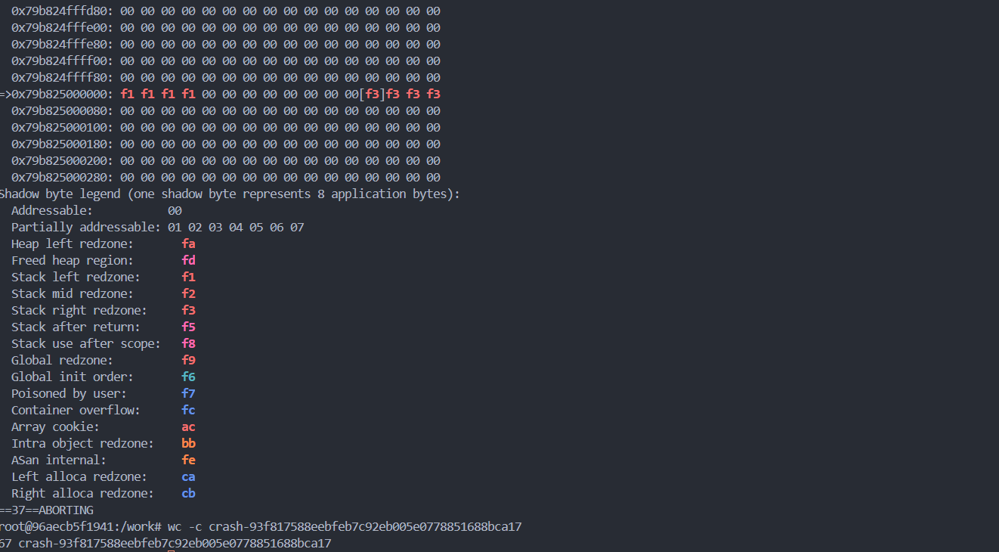
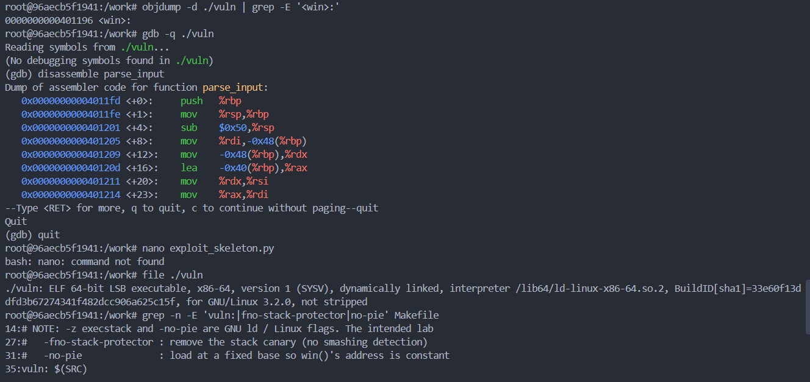
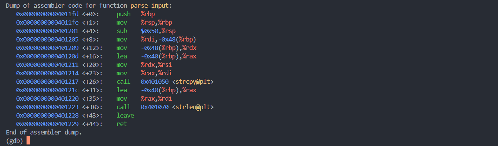
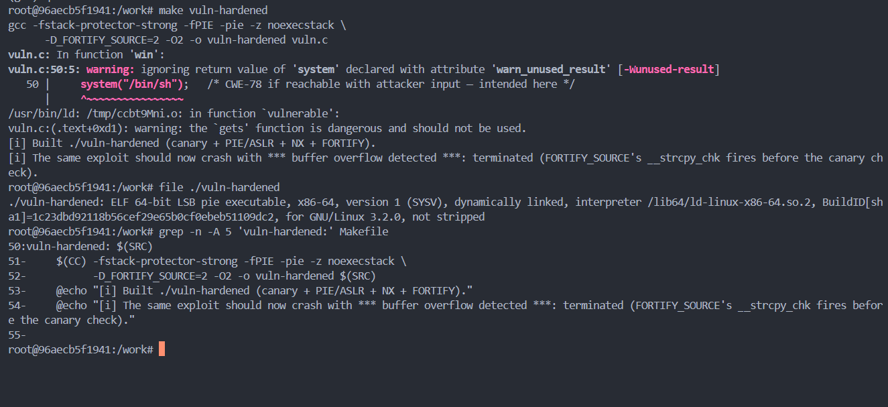
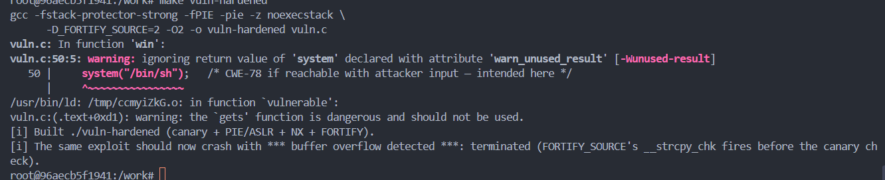
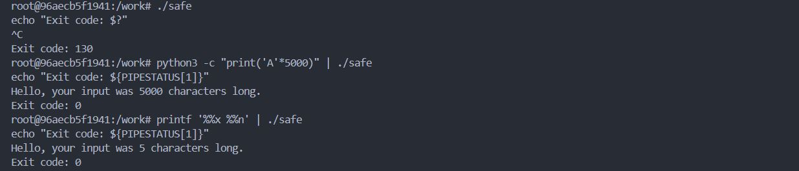

# Worksheet 11 — Memory-Safety & Exploitation (3 hrs)

> **Course:** Software Security (KOSEN69) · Week 11
> **Aligned:** CWE-121 (stack-based buffer overflow) · CWE-787 (out-of-bounds write) · CWE-134 (externally-controlled format string) · CWE-242 (dangerous `gets`)
> **Signature game:** 💥 Fuzzing Race → Pwn the Binary
>
> **Ethics note:** The binaries built from `vuln.c` are **intentionally exploitable** and `win()` spawns `/bin/sh`. Build and run them **only inside the isolated toolbox container** (or a VM) — never on your host. Never run these on a machine you care about, and never aim these techniques at software you are not authorized to test.

## Part 1 — Student Information

| Name | Student ID | Date | Group |
|------|-----------|------|-------|
| Thiwakorn Boayairuksa | 6631503019 | 24/10/2569 |       |

## Part 2 — Lecture Questions

1. Higher memory addresses
+-----------------------------+
| Saved return address        |  Offset 72 from buf[0]
+-----------------------------+
| Saved RBP                   |  Offset 64–71
+-----------------------------+
| buf[64]                     |  Offset 0–63
+-----------------------------+
Lower memory addresses

strcpy() starts writing at the beginning of buf. Because it does not check the destination buffer's capacity, an input longer than the buffer can overwrite adjacent stack data. In the worksheet's stated layout, the saved return address begins at offset 72, so overwriting that value can redirect program execution.

2. gets() reads input without knowing the size of the destination buffer, so an attacker can provide more data than the buffer can hold. This can cause a buffer overflow and corrupt memory. C11 removed gets() from the standard library because it cannot be used safely; bounded input functions such as fgets() should be used instead, with appropriate input-length handling.
3. printf(user_input) is dangerous because it treats the supplied input as a format string. An attacker may insert format specifiers such as %x to disclose data or %n to write the number of characters processed to a memory address supplied through an argument. In contrast, printf("%s", user_input) uses a fixed format string and treats the user input as ordinary text.
4. 
Mitigation	  Purpose
Stack canary	Detects many stack-buffer overflows that corrupt the canary before the function returns.
PIE / ASLR	  Randomizes executable and memory addresses, making fixed-address attacks less reliable.
NX / DEP	    Prevents execution of code placed in non-executable memory regions, such as a typical stack.
FORTIFY	      Uses  fortified library functions and compile-time/runtime checks to detect some unsafe operations and buffer overflows.

- ret2win: PIE/ASLR can invalidate a fixed target address; a stack canary can detect certain overwrites before returning.
- Shellcode on the stack: NX/DEP prevents execution from a non-executable stack.
- Return-address overwrite detection: A stack canary detects many corruptions that cross the canary. FORTIFY can detect certain overflows earlier, depending on the operation and build.
5. Safe Rust prevents ordinary code from writing outside the bounds of a buffer because array and slice accesses are bounds-checked, and safe APIs do not expose unchecked raw memory writes. A String or &str manages the length of text instead of relying on an unchecked C-style buffer operation such as strcpy(). Therefore, the stack-based buffer overflow demonstrated by this worksheet cannot be produced through safe Rust operations, although unsafe code, foreign-function interfaces, or bugs in external components may still introduce memory-safety risks.

## Part 3 — Hands-on Lab (145 min)


**Learning goals:** Find the overflow with a coverage-guided fuzzer, exploit it (ret2win), watch mitigations break the exploit, then port the routine to safe Rust.

**Prerequisites:** the **toolbox container** (bundles `clang`+libFuzzer, `gdb`, `objdump`, `python3`) — Apple clang has no libFuzzer and `gdb` is painful on macOS, so do this week in the container. (`pip install pwntools` and `rustc` inside as needed; an isolated Linux VM also works.)

**Environment setup**
```bash
# from the repo root, build the toolbox once, then open a shell IN this week's folder:
docker build -t softsec-toolbox labs/toolbox
docker run -it --rm --cap-add=SYS_PTRACE --security-opt seccomp=unconfined \
    -v "$PWD/labs/week11-memory-safety-exploitation":/work -w /work softsec-toolbox
# --- inside the container ---
make vuln                                          # teaching build: mitigations OFF
make vuln-hardened                                 # mitigations ON
clang -g -fsanitize=address,fuzzer fuzz_harness.c -o fuzz   # libFuzzer + ASan
setarch `uname -m` -R ./vuln                       # disable ASLR for repeatable addresses
```

**What to submit per task:** the exact command(s) + crash/exploit output, a screenshot, and a 2–3 sentence mitigation note tied to the CWE.

### Task 0 — Onboarding (15 min)
Run `make syntax` (parses both C files even on macOS) and confirm `make vuln` / `make vuln-hardened` build. Read the bug-class banner in `vuln.c`.
**Deliverable:** build output + the list of CWEs `vuln.c` claims to demonstrate.

The make syntax target checks whether the C source files can be parsed. The make vuln target builds the intentionally vulnerable teaching binary, while make vuln-hardened builds a version with additional compiler and runtime protections.
CWEs demonstrated
- CWE-121 — Stack-based Buffer Overflow
- CWE-787 — Out-of-bounds Write
- CWE-134 — Use of Externally-Controlled Format String
- CWE-242 — Use of Inherently Dangerous Function (gets())
### Task 1 — Fuzzing Race: find the crash (35 min)
**Goal:** Make libFuzzer + AddressSanitizer crash on the `strcpy` overflow in `parse_input()` — CWE-121/787.
**Steps:**
1. `./fuzz -runs=100000` (or just `./fuzz`).
2. Read the ASan report — note `stack-buffer-overflow` inside `parse_input` and the saved `crash-<hash>` file.
3. Replay it: `./fuzz crash-<hash>`.
**Deliverable:** the ASan crash summary + the byte length of the crashing input + mitigation note.
Command used:
clang -g -fsanitize=address,fuzzer fuzz_harness.c -o fuzz
./fuzz -runs=100000
Observed result:
AddressSanitizer detected a stack-buffer-overflow in the parse_input() function at fuzz_harness.c:33. The overflow occurred when strcpy() attempted to write 68 bytes into a 64-byte stack buffer. The fuzzer saved the input that triggered the crash as crash-93f817588eebfeb7c92eb005e0778851688bca17.
Mitigation:
The program should validate the input length before copying it into the destination buffer. It should use a bounded and correctly terminated copy, or a safer input-handling design that rejects inputs that exceed the buffer capacity. AddressSanitizer is useful for detecting memory errors during testing, but it does not replace fixing the underlying vulnerability.





### Task 2 — Pwn the Binary: ret2win (40 min)
**Goal:** Overwrite the saved return address so the binary returns into `win()` and prints `FLAG{stack_smashing_for_fun_and_education}` — CWE-121.
**Steps:**
1. Find `win()`'s address: `objdump -d vuln | grep '<win>:'` (or `gdb -batch -ex 'p win' ./vuln`).
2. Verify the offset with a cyclic pattern (do **not** trust 72 blindly): feed `cyclic(200)`, crash in gdb, `cyclic_find` the value in RIP. (On an Apple Silicon/arm64 Mac the toolbox has no platform pin, so it builds as an **aarch64** container — there is no `RIP`; use `info registers pc` / `p/x $pc` instead, and expect `SIGBUS`, not `SIGSEGV`. The offset itself is still 72 here.)
3. Edit `exploit_skeleton.py`: set `WIN_ADDR` to the address from step 1, confirm `OFFSET`.
4. `python3 exploit_skeleton.py` (pwntools path) — or `python3 exploit_skeleton.py | ./vuln`. (On arm64: the flag still prints, but the process then loops forever re-printing `[+] win() reached` instead of exiting — ARM64 keeps the return address in register `x30`, which still holds `win()`'s own address when it starts, so `win()`'s `ret` returns into itself. Expected; `Ctrl-C` once you've captured the flag.)
**Deliverable:** the verified `OFFSET`, your `WIN_ADDR`, and the printed flag / `[+] win() reached` line.


The GDB disassembly shows that parse_input() places the 64-byte buffer at rbp - 0x40 and calls strcpy() without checking the input length. The saved base pointer is at rbp, followed by the saved return address 8 bytes above it, giving an offset of 72 bytes from the start of the buffer to the saved return address.

The win() function is located at 0x401196 in the non-PIE teaching binary. The vulnerable copy can overwrite adjacent stack data when the input is too long. This demonstrates why input-length validation and safe buffer handling are necessary.
### Task 3 — Hardened rebuild: watch the exploit break (25 min)

```sim
stack-frame
```

**Goal:** Observe modern mitigations defeating the same payload.
**Steps:**
1. Run your Task 2 payload against `./vuln-hardened`.
2. Record the failure mode: `*** buffer overflow detected ***: terminated` (FORTIFY_SOURCE's `__strcpy_chk`, which on this build catches the overflow before the stack canary's epilogue check ever runs), or a SIGSEGV at a randomized address (PIE/ASLR makes `WIN_ADDR` wrong).
**Deliverable:** the crash message + a note explaining *which* mitigation fired and why the fixed `WIN_ADDR` no longer works.


Build result: The hardened binary was built successfully with stack-canary protection, PIE/ASLR, NX, and FORTIFY_SOURCE enabled.

Expected protection behavior: Stack canaries detect stack corruption, PIE/ASLR makes fixed code addresses unreliable, and NX prevents execution from a non-executable stack. FORTIFY_SOURCE may detect certain unsafe library operations when the compiler can apply fortified checks.

Conclusion: These mitigations provide defense in depth but do not remove the underlying buffer-overflow vulnerability. The actual runtime error must be recorded to identify which mitigation stopped the payload.

The hardened build enables stack-canary protection, PIE/ASLR, NX, and FORTIFY_SOURCE. The fixed `WIN_ADDR` (`0x401196`) belongs to the original non-PIE binary, `./vuln`. The hardened binary is compiled as PIE, so its load address can change at runtime under ASLR, making the original fixed address unreliable. The actual runtime error must be checked to determine which mitigation fired: a buffer-overflow termination may indicate fortified checking, while a crash at an invalid address may be consistent with an incorrect return address. The inspected disassembly did not show `__strcpy_chk`, so FORTIFY detection through that function has not been confirmed.

### Task 4 — Rust rewrite: defend / fix it (30 min)
**Goal:** Show the bug class disappears in safe Rust using `safe.rs`.
**Steps:**
1. `rustc safe.rs && ./safe`, then `python3 -c "print('A'*5000)" | ./safe` — note it never overflows or crashes.
2. Feed format-string metacharacters: `printf '%%x %%n' | ./safe` — note the program just reports the character count with no crash and no stack leak; the input is treated as ordinary data (CWE-134 impossible: `println!`'s format string must be a compile-time literal, so `println!(line)` would not even compile).
3. From the inline comments, write *why* `String`/`&str` + bounds checks make CWE-121/787 impossible.
**Deliverable:** the safe output for both inputs + a 3–4 sentence explanation tying it to the CISA memory-safe roadmap.

Explanation:
Rust's String and &str types provide length-aware string handling, while safe indexing and bounds checks prevent out-of-bounds memory access. This helps prevent vulnerabilities such as CWE-121 (Stack-based Buffer Overflow) and CWE-787 (Out-of-bounds Write) in safe Rust code. Rust's println! macro requires a compile-time format string, so user input cannot directly become the format string as it can with unsafe C functions such as printf(user_input). This supports CISA's memory-safe roadmap by reducing memory-safety vulnerabilities through the use of memory-safe programming languages.

## Part 4 — Reflection

1. 
Bug	                        Function in vuln.c	                CWE	    Mitigation
Stack buffer overflow	      parse_input()	                      CWE-121	Safe Rust, bounds checks, stack canary
Out-of-bounds write	        parse_input() / unchecked strcpy()	CWE-787	Bounds checking, safe APIs, Rust
Dangerous input function	  gets() usage	                      CWE-242	Replace with fgets() or another bounded input method
Format-string vulnerability	printf(user_input)	                CWE-134	Use printf("%s", user_input)
The vulnerable program demonstrates how unchecked input copying can overwrite memory beyond a stack buffer. Stack canaries, FORTIFY, PIE/ASLR, and NX reduce different parts of the attack surface, but safe input handling addresses the root cause. Safe Rust prevents the demonstrated out-of-bounds write when using safe operations.
2. Heartbleed was a vulnerability in OpenSSL's TLS heartbeat implementation that allowed an attacker to read beyond the intended buffer because the program failed to validate a claimed message length. It is commonly associated with CWE-126, Buffer Over-read, and CWE-125, Out-of-bounds Read. A stack canary would not reliably prevent this type of information disclosure because the issue was an out-of-bounds read rather than a stack return-address overwrite. A memory-safe implementation could prevent this class of bug, assuming the affected code and relevant data handling were implemented using safe abstractions.
3. Hardening C with stack canaries, FORTIFY, NX, and ASLR can improve security quickly and is often practical for existing legacy systems. However, these protections do not eliminate the underlying possibility of memory-safety defects. Rewriting new components in safe Rust can provide more durable risk reduction by preventing many memory-safety errors at compile time, but it requires training, migration effort, interoperability testing, and careful handling of unsafe code and external interfaces.

## Grading rubric (100)

| Criterion | Weight |
|-----------|--------|
| Lecture questions (Part 2) | 20 |
| Exploitation + evidence (Tasks 1–3: fuzz crash, ret2win flag, hardened break) | 40 |
| Defense (Task 4: Rust rewrite + explanation) | 25 |
| Reflection (Part 4: mapping, breach, best mitigation) | 15 |
| **Total** | **100** |

---

## Evidence & Integrity (required)

- **Identity proof:** every screenshot/diagram must show a terminal running `printf '%s | %s | ' "$(whoami)" '<YOUR-STUDENT-ID>'; date '+%F %T %Z'` **in the
  same image as the evidence**. When the evidence is a browser page, a DevTools panel or a
  rendered response, put that terminal **beside the browser and capture the whole screen** — a
  cropped window carries nothing that identifies you, and the lab's own output is
  byte-identical for the whole cohort *by design*, so the stamp is the only thing that makes
  the shot yours. Generic or borrowed evidence is not accepted.
- **Personalized flag (if this lab issues one):** ____________________
  *Flags are unique per student — submitting another student's flag is a violation. How to submit: **learn.zcr.ai/submit** (full guide: `SUBMISSION.md` in the repo root).*
- **Explain in your own words** *(graded on your reasoning, not copied text):*
  1. What did you do, and **why did the vulnerability work**?
  2. **Why does your fix actually stop it** — and what could still break it?

---

## 🤖 Audit the AI (required)

AI is a power tool you must **distrust** — you are graded on your *critique*, not the AI's answer.

1. “Adding a stack canary completely prevents stack buffer overflows. Therefore, enabling compiler protections is sufficient to make the program secure.”
2. The statement “Adding a stack canary completely prevents stack buffer overflows” is incorrect because stack canaries detect certain stack corruptions but do not prevent every out-of-bounds write. The statement “enabling compiler protections is sufficient to make the program secure” is also incomplete because mitigations may not detect every bug and cannot replace correct input validation and memory-safe programming.
3. A proper fix must prevent the program from writing outside the destination buffer, using validated input lengths and safe APIs or safe Rust abstractions. Compiler protections such as stack canaries and FORTIFY should be enabled as defense in depth. The fix must then be verified by rerunning the same test input and confirming that the original failure no longer occurs.

> Disclose your AI use in the Part 1 table. This task counts toward your **Defense + Reflection** score.
AI assistance was used to draft explanations and a remediation plan. Commands, findings, and screenshots must be verified against the actual lab environment before submission.
---

## 🧠 Comprehension & Prompt (required)

**A. Explain in Plain English (EiPE).** The vulnerable C program copies user input into a fixed-size stack buffer without checking whether the input fits. A long input can overwrite adjacent memory, potentially changing the program's control flow. The bug can be prevented by validating input lengths and using safe memory-handling operations.

**B. Prompt Problem.** Write a **single prompt** that makes an AI produce a *correct, secure* fix for one finding. Run it: does the exploit now fail? If not, refine the prompt and try again. Submit the **final prompt + the verified result**.
*Graded on the prompt's precision and your verification — this trains problem decomposition and AI literacy (Denny et al. 2024).*
Review the `parse_input()` function in `vuln.c` for CWE-121 and CWE-787. Identify the exact unsafe operation and explain how an oversized input can write beyond the destination buffer. Propose a minimal secure fix that validates input length and prevents out-of-bounds writes without relying solely on stack canaries or other compiler mitigations. Preserve the program's intended behavior, explain edge cases such as empty input and maximum-length input, and provide a regression test that verifies oversized input is handled safely. Do not claim the fix is verified until it has been compiled and tested.
