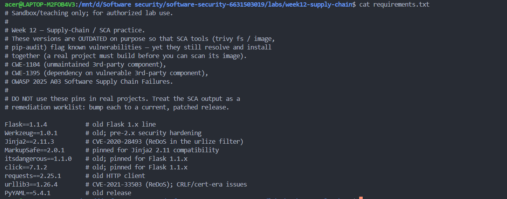
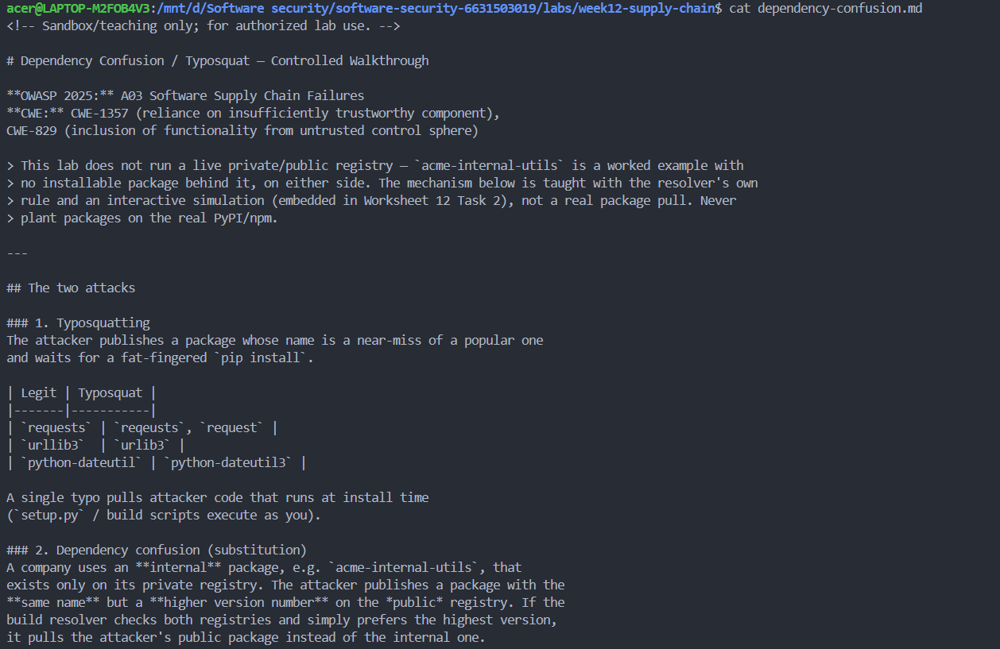
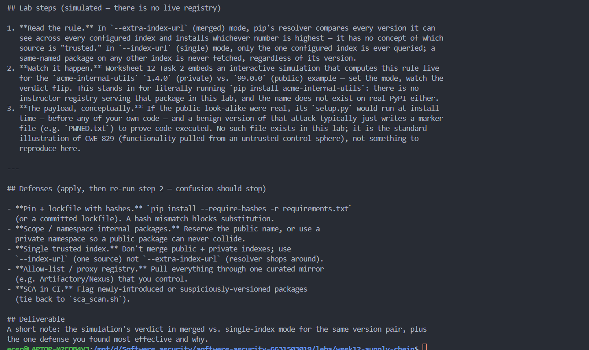
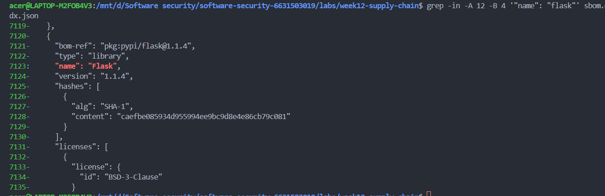
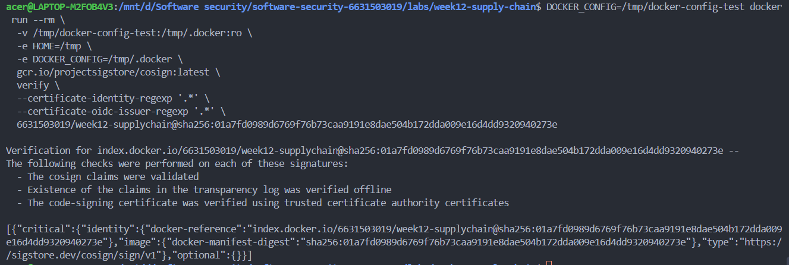
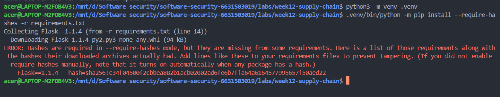
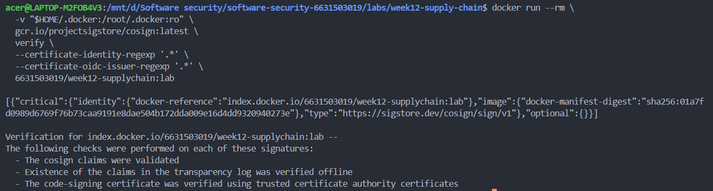

# Worksheet 12 — Software Supply-Chain Security (3 hrs)

> **Course:** Software Security (KOSEN69) · Week 12
> **Aligned:** OWASP 2025 — A03 Software Supply Chain Failures · A08 Software or Data Integrity Failures · **CWE:** CWE-1104, CWE-829, CWE-1357, CWE-1395
> **Signature game:** 📦 Dependency Confusion Heist
>
> **Ethics note:** This lab has **no live private/public registry to attack** — the dependency-confusion exercise is a controlled walkthrough (`dependency-confusion.md`) plus the interactive resolver simulation in Task 2, not a real package pull. **Never** plant or publish look-alike packages on the real PyPI or npm — that is an attack on every downstream user, and nothing in this lab requires it.

## Part 1 — Student Information

| Name | Student ID | Date | Group |
|------|-----------|------|-------|
| Thiwakorn Boayairuksa | 6631503019 | 24/10/2569 |       |

## Part 2 — Lecture Questions

1. Dependency confusion occurs when a package manager selects an attacker-controlled public package that has the same name as an internal package. If the resolver searches both the private and public indexes and chooses the highest version, public acme-internal-utils==99.0.0 can win over private ==1.4.0 because 99.0.0 is numerically higher. The package may then execute code during installation or be included in the application build. Use a single trusted index or explicitly scoped internal names, and verify package hashes and provenance.
2. Typosquatting relies on a developer mistyping a legitimate package name, such as reqeusts instead of requests or urlib3 instead of urllib3. If the misspelled package exists in a registry, the package manager may install it. Its setup/build scripts or installation hooks may execute during installation, before the application’s own code runs, so the malicious code can steal secrets or alter the build environment. Verify package names and publishers, lock dependencies, and use trusted registries and automated scanning.
3. A Software Bill of Materials (SBOM) is a machine-readable inventory of the components in a software product, including packages and versions. CycloneDX and SPDX are common SBOM formats. During incident response, an SBOM helps teams quickly identify whether a vulnerable or malicious component is present and which builds are affected. It also provides component context that can be associated with build provenance, although an SBOM alone does not prove where a component came from or that the build is trustworthy.
4. Sigstore keyless signing uses an OIDC identity to obtain a short-lived signing certificate from Fulcio and records signing information in the Rekor transparency log. This reduces reliance on long-lived private keys that can be lost, copied, or stolen, which is the risk described by CWE-321. Verification can check the certificate identity, issuer, signature, and transparency evidence. Keyless signing still depends on securing the OIDC identity and CI workflow; it does not automatically prove that the source code is safe.
5. SLSA is a framework for improving the integrity and verifiability of software artifacts and their build process. Broadly, higher levels require stronger, more trustworthy provenance and a more controlled, hardened build platform; exact requirements depend on the SLSA version and track. A signed artifact, SBOM, and a deployment gate are valuable controls, but these items alone do not determine a SLSA level. To claim a level, the team must also demonstrate that provenance is generated and authenticated by the required build process and meet the relevant build-platform requirements. A hardened, isolated build platform and protection against tampering with the build process may still be missing.


## Part 3 — Hands-on Lab (150 min)

**Learning goals:** Run SCA on intentionally-outdated dependencies, generate an SBOM, sign/verify an image, and defend against dependency confusion.

**Prerequisites:** Docker; the lab folder (`requirements.txt`, `Dockerfile`, `app.py`, `sca_scan.sh`, `sign.sh`). For signing: browser for the OIDC flow + registry push access.

**Environment setup**
```bash
cd labs/week12-supply-chain
bash sca_scan.sh                 # trivy fs + pip-audit on requirements.txt (+ optional image scan)
docker build -t week12-supplychain:lab .
bash sign.sh week12-supplychain:lab   # CycloneDX SBOM -> sbom.cdx.json, then cosign sign + verify
```

**What to submit per task:** the exact command(s) + output, a screenshot, and a 2–3 sentence remediation note mapping the finding to A03/A08 or the CWE.

### Task 0 — Onboarding (15 min)
Read `requirements.txt` and list the pinned packages with their versions. Note why they are intentionally outdated (each is deliberately an old release so SCA tools flag its known CVEs).
**Deliverable:** the package/version table + which OWASP/CWE this maps to.

The dependencies are intentionally pinned to older versions so that Software Composition Analysis (SCA) tools can identify known vulnerabilities. This maps to OWASP A03 — Software Supply Chain Failures. Relevant CWEs include CWE-1104 for the use of unmaintained third-party components and CWE-1395 for dependencies on vulnerable third-party components, when supported by the actual findings.
### Task 1 — SCA scan: build the remediation worklist (35 min)
**Goal:** Flag the known-vulnerable dependencies — A03.
**Steps:**
1. `bash sca_scan.sh` — read the `trivy fs` table (CVE, installed vs. fixed version) and the `pip-audit` advisory IDs (GHSA-/PYSEC-).
2. Pick three findings; record CVE/advisory id, severity, and the fixed version.
**Deliverable:** the SCA output + a 3-row remediation table (package → current → fixed).

### Task 2 — Dependency Confusion Heist (35 min)
**Goal:** Watch the wrong package win — A03 / CWE-1357.

**Reality check:** this lab does **not** stand up a live private/public registry. `acme-internal-utils` is
a worked example, not an installable package — there is nothing to actually `pip install` here (the name
doesn't exist on real PyPI either, so don't expect that to work as a shortcut). Task 2 is a controlled
walkthrough of the resolver's own rule, using the simulation below, which computes the real
"highest version wins" logic live instead of just asserting the outcome.

```sim
resolver-confusion
```

**Steps:**
1. Read `dependency-confusion.md`'s "Dependency confusion (substitution)" section for the mechanism.
2. In the simulation, load the **"the attack"** preset (private `1.4.0`, public `99.0.0`, merged /
   `--extra-index-url` mode) and record which index the resolver picks and why.
3. Keep the same version numbers and switch to the **single-index** (`--index-url`) mode; record how the
   verdict changes — this is the resolver behavior Task 4's "single trusted index" defense relies on.
4. Try the **"win the race"** preset (private version numerically higher than public) and note why the
   sim's own explanation calls that "not a defense."

**Deliverable:** a screenshot of the simulation's verdict in both index modes (merged vs. single) for the
same version pair, plus one sentence on why an attacker defeats the "keep my internal version number high"
idea.


In merged-index mode (--extra-index-url), the resolver selects the public package version 99.0.0 instead of the private version 1.4.0 because it can choose the higher available version across the configured indexes.

When switched to a single trusted private index (--index-url), the resolver selects the private version 1.4.0. Keeping the internal version number artificially high is not a reliable defense because an attacker can publish an even higher public version. Using a single trusted package index reduces this dependency-confusion risk.

Mitigation: Use a single trusted package index and enforce package provenance and integrity controls. This addresses OWASP A03: Software Supply Chain Failures and CWE-1357.

### Task 3 — SBOM + signing/verification (30 min)
**Goal:** Produce a component inventory and prove integrity — A08.
**Steps:**
1. After `bash sign.sh week12-supplychain:lab`, open `sbom.cdx.json` and find Flask's entry.
2. Read the `cosign verify` PASS for the signed image.
3. Negative test on an unsigned image (it **must** fail):
   `cosign verify --certificate-identity-regexp '.*' --certificate-oidc-issuer-regexp '.*' python:3.9-slim`
   → `Error: no signatures found`. (Both `--certificate-identity*` flags are required in keyless mode; without
   them cosign stops at `Error: --certificate-identity or --certificate-identity-regexp is required` — a usage
   error, which is *not* the same thing as proving the image is unsigned.)
**Deliverable:** the SBOM Flask component entry + the verify PASS + the negative-test failure.


I generated an SBOM for the Docker image using Trivy. The SBOM identified Flask version 1.1.4 with the package reference pkg:pypi/flask@1.1.4 and license BSD-3-Clause.

I pushed the image to Docker Hub and signed its digest using Cosign with a Sigstore identity. The verification succeeded: Cosign validated the claims, checked the transparency log, and verified the signing certificate against trusted certificate authorities.

As a negative test, verifying an unsigned image returned no signatures found, demonstrating that Cosign did not find a valid signature for that image.

### Task 4 — Defend / fix it (35 min)
**Goal:** Stop dependency confusion and lock integrity — defenses from `dependency-confusion.md` + `sign.sh`.
**Steps:**
1. **Pin + hashes:** run `pip install --require-hashes -r requirements.txt` against this lab's own
   `requirements.txt` (it has no hashes yet) and record pip's refusal — `ERROR: Hashes are required in
   --require-hashes mode...` plus the `--hash=sha256:…` line pip prints for you. That refusal is the same
   mechanism that would block a real confusion substitution: once hashes are required, a package that
   doesn't match — from *either* index — cannot install silently.
2. **Single trusted index:** use one `--index-url` instead of `--extra-index-url`; explain why the resolver stops shopping around (tie this back to Task 2's single-index verdict).
3. **Namespace scoping:** describe reserving/namespacing the internal package name.
4. **Provenance gate:** state how the `cosign verify` from `sign.sh` becomes a gate before a simulated deploy.
**Deliverable:** the `--require-hashes` refusal output (step 1) + the simulation's before/after verdict for merged vs. single index (from Task 2) + the one defense you found most effective and why.
//I ran python3 -m venv .venv and then .venv/bin/python -m pip install --require-hashes -r requirements.txt. Pip rejected the installation because the requirements file did not include the required hashes. Hash verification helps ensure that downloaded package artifacts match approved expected values, reducing the risk of installing substituted or tampered packages.
Internal packages should use a clearly defined namespace or naming convention controlled by the organization. The organization should restrict who can publish internal packages and configure package resolution to use the trusted internal registry. This reduces the risk of accidentally installing a public package with the same name.
//I verified the Docker image 6631503019/week12-supplychain:lab using Cosign. Verification succeeded: the claims were validated, the transparency log evidence was verified offline, and the signing certificate was verified against trusted certificate authorities. In a deployment pipeline, the image should be deployed only if signature verification and the required identity, issuer, and provenance policy checks pass. A valid signature alone does not guarantee that the image is free from vulnerabilities or malicious code.

## Part 4 — Reflection

1. | Finding / risk | Tool | OWASP 2025 category | CWE | Fix |

| Known vulnerable or unmaintained dependency | `sca_scan.sh` (Trivy / pip-audit) | A03 — Software Supply Chain Failures | CWE-1104 and/or CWE-1395, where supported by the finding | Upgrade to an advisory-confirmed fixed version; pin and retest |
| Dependency confusion from a less-trusted registry | Resolver simulation / `dependency-confusion.md` | A03 — Software Supply Chain Failures | CWE-1357 (course mapping) | Single trusted index, namespace scoping, hashes |
| Artifact lacks a verifiable signature or fails integrity policy | `sign.sh` / `cosign verify` | A08 — Software or Data Integrity Failures | Use the CWE matching the actual integrity/provenance failure; do not force a mapping without evidence | Verify signatures, identity/issuer, provenance, and block deployment on failure |
| Dependency artifact changes without matching the pinned digest | `pip --require-hashes` | A08 and supply-chain integrity controls | CWE-829 may be relevant where code from an untrusted control domain is included; confirm scope | Verify exact artifact hashes and source trust |
2. The XZ Utils incident involved malicious changes introduced into releases of a widely used compression utility, with the backdoor targeting certain Linux environments through the build and distribution chain. It is primarily a software supply-chain and software-integrity failure, mapping to OWASP A03 and A08. An SBOM could help identify which products included affected XZ versions, but an SBOM alone would not identify malicious behavior or prove that the source was trustworthy. Signature verification would only establish that an artifact was signed by the expected identity; if a trusted upstream release itself were maliciously modified and then legitimately signed, a signature alone might still pass. Strong provenance, review of source and build changes, reproducible or independently verifiable builds, and anomaly detection provide additional defense.
3. The highest-leverage immediate control for the dependency-confusion scenario is to use a single trusted package index and prevent dependency resolution from silently searching an untrusted public index. Exact version pins and hashes, internal namespace controls, SCA scanning, and signature/provenance gates should reinforce that control. Based only on the worksheet controls, I would not claim a specific SLSA level yet: the presence of an SBOM, a signed artifact, and a deployment gate does not prove that the build process generates authenticated provenance or meets the required build-platform protections. The team should assess the applicable SLSA requirements and verify provenance generation, build service identity, isolation, and resistance to tampering before claiming a level.

## Grading rubric (100)

| Criterion | Weight |
|-----------|--------|
| Lecture questions (Part 2) | 20 |
| Exploitation + evidence (Tasks 1–3: SCA findings, confusion proof, SBOM/verify) | 40 |
| Defense (Task 4: pinning/hashes, single index, scoping, provenance gate) | 25 |
| Reflection (Part 4: mapping, XZ breach, SLSA self-assessment) | 15 |
| **Total** | **100** |

---

## Evidence & Integrity (required)

- **Identity proof:** every screenshot/diagram must show a terminal running `printf '%s | %s | ' "$(whoami)" '<YOUR-STUDENT-ID>'; date '+%F %T %Z'` **in the
  same image as the evidence**. When the evidence is a browser page, a DevTools panel or a
  rendered response, put that terminal **beside the browser and capture the whole screen** — a
  cropped window carries nothing that identifies you, and the lab's own output is
  byte-identical for the whole cohort *by design*, so the stamp is the only thing that makes
  the shot yours. Generic or borrowed evidence is not accepted.
- **Personalized flag (if this lab issues one):** ____________________
  *Flags are unique per student — submitting another student's flag is a violation. How to submit: **learn.zcr.ai/submit** (full guide: `SUBMISSION.md` in the repo root).*
- **Explain in your own words** *(graded on your reasoning, not copied text):*
  1. What did you do, and **why did the vulnerability work**?
  2. **Why does your fix actually stop it** — and what could still break it?

---

## 🤖 Audit the AI (required)

AI is a power tool you must **distrust** — you are graded on your *critique*, not the AI's answer.

1. “Use a single trusted package index, pin dependency versions and hashes, generate an SBOM, and require signature/provenance verification before deployment.”
2. This advice is directionally useful but incomplete if treated as proof that the system is secure. Version pins alone do not verify package contents, and a hash only helps if the hash is obtained from a trusted source and matches the intended artifact. A signature proves a signing relationship, not that the code is benign; the expected identity, issuer, source revision, build workflow, and provenance policy must also be checked. The advice also does not prove a SLSA level without evidence that the build process meets the relevant requirements.
3. backed fixed versions. Use a single trusted index and generate hashes for the exact approved artifacts; then verify the signed image and provenance against the expected identity and policy before deployment. Verification must be demonstrated by the real command output and the unsigned-image negative test, not assumed from the command’s presence. The evidence fields above must be completed from the user’s actual lab run.

> Disclose your AI use in the Part 1 table. This task counts toward your **Defense + Reflection** score.
AI assistance was used to draft explanations and a remediation plan. Commands, findings, and screenshots must be verified against the actual lab environment before submission.
---

## 🧠 Comprehension & Prompt (required)

**A. Explain in Plain English (EiPE).** A package manager may install a dependency from a less-trusted public registry if it searches multiple indexes and chooses the highest version, even when a package with the same name exists internally. A malicious or vulnerable dependency can run during installation or enter the build, so the risk exists before the application is deployed. Trusted indexes, hash checking, scanning, and provenance verification reduce the chance of accepting an unexpected or tampered component.

**B. Prompt Problem.** Write a **single prompt** that makes an AI produce a *correct, secure* fix for one finding. Run it: does the exploit now fail? If not, refine the prompt and try again. Submit the **final prompt + the verified result**.
*Graded on the prompt's precision and your verification — this trains problem decomposition and AI literacy (Denny et al. 2024).*
“You are reviewing a Python software supply-chain configuration for dependency confusion. Inspect the provided requirements.txt, package-index configuration, and build/deploy scripts. Do not invent package versions, hashes, CVEs, registry URLs, or tool output. Identify how a public package could be selected instead of an internal package. Propose a minimal fix that uses one explicitly trusted index, exact dependency pins and verified hashes, and a deployment gate that verifies the expected cosign certificate identity, OIDC issuer, and build provenance. Preserve required functionality, explain remaining risks, and provide exact test commands. State which tests must fail before the fix and pass after it. Do not claim the fix works until the commands have been run and their actual output is reviewed.”