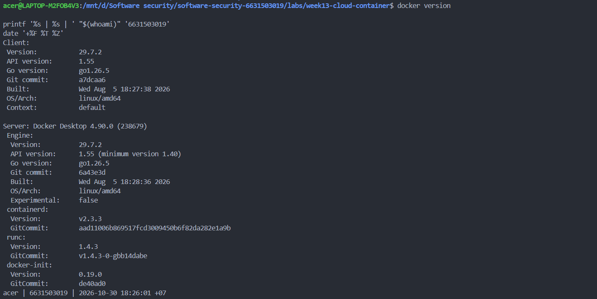
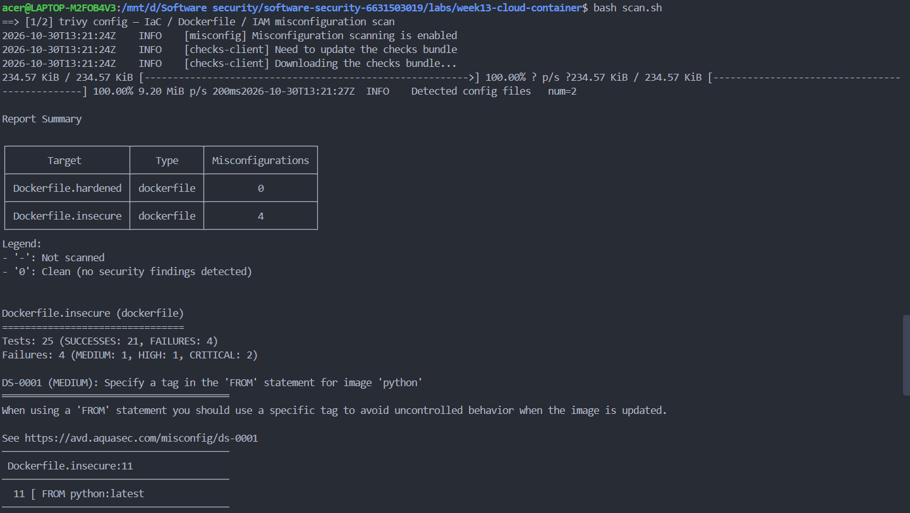
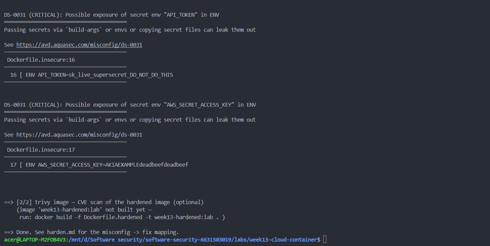
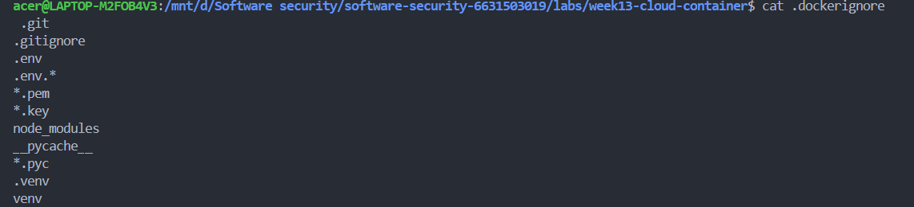

# Worksheet 13 — Cloud & Container Security (4 hrs)

> **Course:** Software Security (KOSEN69) · Week 13
> **Aligned to:** OWASP 2025 **A02 Security Misconfiguration** · **CWE-732** (incorrect permission assignment), **CWE-16** (configuration), plus CWE-798, CWE-250, CWE-538, CWE-269, CWE-1104
> **Signature game:** 🔍 *Misconfig Hunt* (CloudGoat-style) — each misconfig you find **and** fix = a flag.

> ⚠️ **Ethics note:** All artifacts here are deliberately broken for teaching and are marked *"Sandbox/teaching only; for authorized lab use."* Scan, exploit, and harden **only** these lab files (or systems you own / are authorized to test). Never point Trivy or these techniques at third-party cloud accounts or images without written permission.

---

## Part 1 — Student Information

| Name | Student ID | Date | Group |
|------|-----------|------|-------|
| Thiwakorn Boayairuksa | 6631503019 | 30/10/2569 |       |

---

## Part 2 — Lecture Questions

Answer in your own words (2–4 sentences each).

1. The shared-responsibility model means that the cloud provider is responsible for securing the cloud infrastructure, while the customer is responsible for securing the resources and data they deploy in the cloud. For an S3-backed application, AWS is responsible for protecting the physical data centers and underlying storage infrastructure. The application owner is responsible for configuring S3 bucket permissions correctly, preventing public access, and protecting stored data.
2. Using "Action": "*" and "Resource": "*" grants permissions to perform almost any action on any resource. This violates the principle of least privilege because the identity receives more permissions than it needs. CWE-732 relates to assigning incorrect permissions to a resource, while CWE-269 describes improper privilege management, such as granting excessive privileges to an identity.
3. An attacker who obtains a Docker image can inspect its configuration using docker inspect and examine its build history using docker history --no-trunc. If a secret is stored in a Dockerfile using an ENV instruction, it may be exposed in the image configuration or build history. This is CWE-798 because the application contains hard-coded credentials, and CWE-200 because sensitive information is exposed to unauthorized users.
4. The latest tag can point to different image versions over time, so rebuilding the same Dockerfile may produce a different environment. This makes builds difficult to reproduce and may introduce unexpected vulnerabilities or breaking changes. Pinning the base image to an immutable @sha256: digest ensures that the build uses the exact image content that was reviewed and approved.
5. A distroless image removes unnecessary operating-system components such as package managers, shells, and many command-line utilities that are commonly available in a general-purpose image like python:3.11-slim. This reduces the number of tools an attacker can use after exploiting an application through RCE. It also reduces unnecessary software and dependencies inside the runtime container, although it does not completely prevent container escapes.

---

## Part 3 — Hands-on Lab (180 min)

**Learning goals:** find cloud/container misconfigurations with Trivy, map each to a CWE, and rebuild the IAM policy + Dockerfile to least privilege / hardened so the findings drop.

**Prerequisites:** Docker installed and running; the `week13-cloud-container/` lab folder; internet access to pull `aquasec/trivy:latest`.

### Environment setup (real commands)

```bash
cd labs/week13-cloud-container

# Option A — the provided wrapper (trivy config over the Dockerfiles; IAM JSON is reviewed manually, see Task 2):
bash scan.sh

# Option B — run Trivy directly (MEDIUM is in the filter on purpose: one of the
# three rules Task 1 asks you to cite is rated MEDIUM, and HIGH,CRITICAL hides it):
docker run --rm -v "$PWD:/src" aquasec/trivy:latest config --severity MEDIUM,HIGH,CRITICAL /src

# (Optional) build + CVE-scan the hardened image:
docker build -f Dockerfile.hardened -t week13-hardened:lab .
docker run --rm -v /var/run/docker.sock:/var/run/docker.sock aquasec/trivy:latest image --severity HIGH,CRITICAL week13-hardened:lab
```

**What to submit per task:** the command(s) you ran + the relevant output (finding count or the specific finding line), a screenshot of the Trivy/terminal result, and a 2–3 sentence mitigation explaining *why* the fix reduces risk (cite the CWE).


### Tasks

- **Task 0 — Onboarding (15 min).** Confirm Docker works (`docker version`), run `bash scan.sh`, and record the **baseline finding count** against `Dockerfile.insecure` (Trivy's `config` scanner does not parse standalone IAM policy JSON, so `iam-policy-insecure.json` is reviewed manually instead — see Task 2). **Deliverable:** screenshot of the baseline scan.




- **Task 1 — Misconfig Hunt: container image (40 min).** *Goal:* find every defect in `Dockerfile.insecure`. *Steps:* read each `# DEFECT:` comment, then locate the matching Trivy finding where one exists — only 3 of the 6 (unpinned `:latest`, runs as root, secrets in `ENV`) map to a Trivy config rule (`DS-0001`, `DS-0002`, `DS-0031`); `COPY . .`, `chmod -R 777`, and unpinned `pip install` are instruction-level RUN/COPY semantics Trivy's Dockerfile scanner doesn't check, so identify those 3 by code review instead. Build a table: defect → CWE → Trivy rule/severity (write "manual review — no Trivy rule" where none exists). *Deliverable:* completed table (6 rows) using the IDs from `harden.md`.

Defect	                                                CWE	                Trivy rule / severity
FROM python:latest	                                    CWE-1104 / CWE-16	  DS-0001 — MEDIUM
Secrets in ENV (API_TOKEN, AWS_SECRET_ACCESS_KEY)	      CWE-798 / CWE-200	  DS-0031 — CRITICAL (2 findings)
COPY . .	                                              CWE-538	            Manual review — no Trivy rule
chmod -R 777 /app	                                      CWE-732	            Manual review — no Trivy rule
Runs as root (no USER)	                                CWE-250	            DS-0002 — HIGH
Unpinned pip install	                                  CWE-1104	          Manual review — no Trivy rule

- **Task 2 — Misconfig Hunt: IAM (30 min).** *Goal:* document why `iam-policy-insecure.json` is full-admin. *Steps:* identify the `Action:*` / `Resource:*` / no-`Condition` problems; map to CWE-269 / CWE-732. *Deliverable:* 3-row table + one sentence on the blast radius if these creds leak.

	Misconfiguration	CWE	    Explanation
	"Action": "*"	    CWE-269	Allows every AWS action instead of only the actions required by the application.
	"Resource": "*"	  CWE-732	Grants permissions across all resources instead of restricting access to specific resources.
	No Condition	    CWE-732	Does not restrict access using additional conditions such as an allowed S3 prefix.

  If these credentials are leaked, an attacker could perform almost any AWS operation on any accessible resource because the policy grants full administrative-level permissions. This could result in unauthorized data access, modification, deletion, or further compromise of cloud resources.

- **Task 3 — Secrets & storage (25 min).** *Goal:* show secrets must not live in the image. *Steps:* explain how `ENV API_TOKEN` / `AWS_SECRET_ACCESS_KEY` are exposed via `docker history`; propose where they belong instead (secrets manager / mounted secret / orchestrator secret per `harden.md`). *Deliverable:* 2–3 sentence remediation + the `.dockerignore` entries you would add to stop `COPY . .` leaking `.git`/`.env` (CWE-538).
The ENV API_TOKEN and AWS_SECRET_ACCESS_KEY values are stored in Docker image layers, so anyone with access to the image can recover them using docker history --no-trunc or inspect the image configuration. Instead of baking secrets into the image, they should be injected at runtime through a secrets manager, mounted secret files, or orchestrator-managed secrets (such as Docker Secrets or Kubernetes Secrets). This prevents credentials from being permanently embedded in the image and reduces the risk of information exposure (CWE-798, CWE-200).



- **Task 4 — Hardened-Dockerfile + least-priv-IAM defense (50 min).** *Goal:* prove the "after" is clean. *Steps:* (a) re-run `bash scan.sh` (or `trivy config`) against `Dockerfile.hardened` and capture the **reduced** finding count (Trivy's config scanner does not parse standalone IAM JSON, so confirm the IAM fix manually per Task 2 by diffing `iam-policy-leastpriv.json` against the insecure policy); (b) for the Dockerfile, point to the fix for each Task-1 defect (digest pin, multi-stage venv, distroless runtime, `USER 65532:65532`, no secrets in `ENV`, copy only `app.py`); (c) for IAM, confirm the rewrite scopes `s3:GetObject` to `arn:aws:s3:::lab-app-bucket/app/*` and adds the `s3:prefix` `Condition`; (d) list the extra runtime flags from `harden.md` (`--read-only`, `--cap-drop ALL`, `--security-opt no-new-privileges`). *Deliverable:* before/after finding counts, the defect→fix mapping, and the diffed policy/Dockerfile with one sentence per fix.

Trivy Configuration Scan Results
Severity	Before: Dockerfile.insecure	After: Dockerfile.hardened
MEDIUM	  1	                          0
HIGH	    1	                          0
CRITICAL	2	                          0
Total	    4	                          0

Container Security
Original defect	                   CWE	              Fix applied
FROM python:latest	               CWE-1104, CWE-16	  Pin the Python base image using a SHA256 digest.
Hard-coded secrets in ENV	CWE-798, CWE-200	          Remove secrets from the image and inject them at runtime.
COPY . .	                         CWE-538	          Copy only requirements.txt and app.py, and use .dockerignore.
chmod -R 777 /app	                 CWE-732	          Remove world-writable permissions and avoid unnecessary file access.
No non-root USER	                 CWE-250	          Run the application as UID/GID 65532.
Unpinned dependency installation	 CWE-1104	          Install dependencies through a virtual environment using requirements.txt.

IAM Security 
Original defect	CWE	    Fix applied
"Action": "*"	  CWE-269	Replace wildcard actions with s3:GetObject and s3:ListBucket.
"Resource": "*"	CWE-732	Restrict resources to the specified S3 bucket and app/* object prefix.
No Condition	  CWE-732	Add an s3:prefix condition to restrict s3:ListBucket.

Dockerfile Diff — One Sentence per Fix
Based on diff -u Dockerfile.insecure Dockerfile.hardened:

1. Base image: Replaced FROM python:latest with a Python 3.11 slim image pinned by SHA256 digest to improve build reproducibility.

2. Secrets: Removed hard-coded API_TOKEN and AWS_SECRET_ACCESS_KEY environment variables to prevent credentials from being exposed in image layers.

3. Build context: Replaced COPY . . with selective copying of requirements.txt and app.py to avoid including unnecessary or sensitive files.

4. File permissions: Removed chmod -R 777 /app to prevent unrestricted write access to application files.

5. Dependency installation: Created a Python virtual environment and installed dependencies using pip install --no-cache-dir -r requirements.txt.

6. Runtime image: Added a Distroless Python runtime stage to reduce the image's attack surface and exclude unnecessary build tools.

7. Non-root execution: Added USER 65532:65532 to run the application without root privileges.

8. Runtime environment: Configured PATH and PYTHONPATH to use the copied virtual environment without embedding application secrets.

IAM Policy Diff — One Sentence per Fix
Based on diff -u iam-policy-insecure.json iam-policy-leastpriv.json:

1. Action restriction: Replaced "Action": "*" with s3:GetObject and s3:ListBucket to allow only the required S3 operations.

2. Resource restriction: Replaced "Resource": "*" with arn:aws:s3:::lab-app-bucket/app/* for object access and arn:aws:s3:::lab-app-bucket for bucket listing.

3. Condition: Added a StringLike condition on s3:prefix with app/* to restrict the objects that can be listed within the bucket.

- **Task 5 — Flag tally (20 min).** *Goal:* score the hunt. *Steps:* one flag per misconfig found **and** fixed (6 container + 3 IAM = 9). *Deliverable:* flag count + the single biggest-risk misconfig and why.

---

## Part 4 — Reflection

1. 
Artifact line / finding	                CWE	              OWASP 2025	                  One-line fix
Dockerfile: ENV API_TOKEN=...	          CWE-798 / CWE-200	A02 Security Misconfiguration	Remove secrets from the image and use a secrets manager
Dockerfile: USER root or no USER	      CWE-250 / CWE-732	A02 Security Misconfiguration	Run the application as a non-root user
IAM: "Action": "*" and "Resource": "*"	CWE-269 / CWE-732	A02 Security Misconfiguration	Restrict actions and resources to the minimum required

2. In 2019, Capital One disclosed a data breach involving unauthorized access to data stored in its cloud environment. The incident involved exploitation of a server-side request forgery (SSRF) vulnerability and access to cloud resources through an overly permissive IAM role. A least-privilege IAM policy could have reduced the attacker's access to sensitive resources and limited the impact of the breach.
3. Least-privilege IAM provides significant risk reduction because it limits what an attacker can do if credentials or an application are compromised. Distroless images and non-root execution reduce the container attack surface, but they do not restrict access to cloud resources. Therefore, least-privilege IAM is especially important for reducing the potential impact of compromised cloud credentials, while container hardening provides an additional layer of defense.

---

## Grading rubric (100)

| Component | Points | What earns full marks |
|-----------|:------:|-----------------------|
| Part 2 — Lecture questions | 20 | All 5 answered correctly with CWE/A02 reasoning |
| Part 3 — Tasks + evidence | 40 | Tasks 0–5 complete; commands, outputs, and screenshots present |
| Defense (Task 4 hardening) | 25 | Hardened Dockerfile + least-priv IAM shown to reduce findings; per-fix justification |
| Part 4 — Reflection | 15 | Accurate mapping, relevant incident, well-argued best mitigation |

---

## Evidence & Integrity (required)

- **Identity proof:** every screenshot/diagram must show a terminal running `printf '%s | %s | ' "$(whoami)" '<YOUR-STUDENT-ID>'; date '+%F %T %Z'` **in the
  same image as the evidence**. When the evidence is a browser page, a DevTools panel or a
  rendered response, put that terminal **beside the browser and capture the whole screen** — a
  cropped window carries nothing that identifies you, and the lab's own output is
  byte-identical for the whole cohort *by design*, so the stamp is the only thing that makes
  the shot yours. Generic or borrowed evidence is not accepted.
- **Personalized flag (if this lab issues one):** ____________________
  *Flags are unique per student — submitting another student's flag is a violation. How to submit: **learn.zcr.ai/submit** (full guide: `SUBMISSION.md` in the repo root).*
- **Explain in your own words** *(graded on your reasoning, not copied text):*
  1. What did you do, and **why did the vulnerability work**?
  2. **Why does your fix actually stop it** — and what could still break it?

---

## 🤖 Audit the AI (required)

AI is a power tool you must **distrust** — you are graded on your *critique*, not the AI's answer.

1. Remove the ENV API_TOKEN instruction from the Dockerfile and pass the token through an environment variable when running the container.
2. "pass the token through an environment variable when running the container."
This suggestion is incomplete because passing a secret through a normal environment variable at runtime does not automatically provide secure secret management. The value may still be exposed through container inspection, process information, logs, or deployment configuration depending on the environment. A mounted secret or a dedicated secrets manager is a safer approach.
3. Remove the secret from the Dockerfile completely and retrieve it from a secrets manager or a mounted secret at runtime. The application should read the secret from the protected secret file or approved secret provider. Verify the built image by inspecting its environment variables and build history to ensure that the secret is not embedded in the image.

> Disclose your AI use in the Part 1 table. This task counts toward your **Defense + Reflection** score.

---

## 🧠 Comprehension & Prompt (required)

**A. Explain in Plain English (EiPE).** The vulnerable Dockerfile builds a container image that includes an embedded API token, runs with excessive privileges, and may copy unnecessary files into the image. An attacker who obtains the image can inspect its metadata or history to discover exposed secrets, while excessive permissions can increase the impact of a successful attack. These weaknesses can be reduced by removing secrets, using a non-root user, restricting copied files, and applying least-privilege permissions.

**B. Prompt Problem.** Write a **single prompt** that makes an AI produce a *correct, secure* fix for one finding. Run it: does the exploit now fail? If not, refine the prompt and try again. Submit the **final prompt + the verified result**.
*Graded on the prompt's precision and your verification — this trains problem decomposition and AI literacy (Denny et al. 2024).*
Act as a senior DevSecOps engineer. Review the files `Dockerfile.insecure`, `Dockerfile.hardened`, and `harden.md` in `labs/week13-cloud-container/`.

Focus on the hard-coded secret vulnerability (CWE-798 and CWE-200).

Requirements:
1. Identify every location where secrets such as `API_TOKEN` or `AWS_SECRET_ACCESS_KEY` could be embedded in the Docker image.
2. Remove hard-coded secrets from Dockerfile instructions, including `ENV` and build arguments that could expose credentials.
3. Do not replace the secret with another hard-coded value or print a real secret in logs.
4. Explain how the application should receive secrets securely using the secret-management approach documented in `harden.md`.
5. Preserve the application's existing functionality.
6. Show the exact code changes as a unified diff.
7. Provide commands to build the image and inspect its configuration and history.
8. Do not claim that the vulnerability is fixed until the image has actually been built and inspected.
9. Explain any remaining limitations and potential exposure paths.

Return the findings, patch, verification commands, and a short explanation of why the fix addresses CWE-798 and CWE-200.
