# Term Project Report — Secure Build (NoteVault)

| Field | Value |
|---|---|
| Team name | TSC |
| Members Thiwakorn Boayairuksa 6631503019 | TEAM_ID TSC;|
| Target application | `project/starter-app` |
| Repository URL | Local course repository |
| Date | 2026-11-06 |

## AI-tool usage disclosure

| Tool | How it was used |
|---|---|
| GitHub Copilot SDK in VS Code | Assisted with code inspection, secure implementation, test authoring, and report drafting; all commands and results were locally verified. |

## 1. Executive Summary

NoteVault is a local Flask note-sharing application with registration, login, notes,
search, an admin JSON endpoint, and note export. The baseline had confirmed SQL
injection, XSS, broken object-level authorization, role escalation, command
injection, password-hash disclosure, weak password storage, insecure session
configuration, CSRF exposure, and vulnerable dependency/container defaults. The
remediated build uses parameterized SQL, Jinja autoescaping, ownership checks,
server-assigned roles, Werkzeug's password KDF for the seeded demo data,
CSRF tokens, strict JWT algorithms, protected cookies, allow-listed export formats,
non-root Docker, runtime secrets, and current dependency pins.

Local evidence: `pytest -q test_app.py` — **7 passed**; Docker build succeeded;
container `GET /` returned HTTP 200; `pip-audit -r requirements.txt` reported
**No known vulnerabilities found**. Cosign and GitHub provenance are configured but
not claimed as completed locally because no registry, signing identity, or GitHub
Actions run was available.
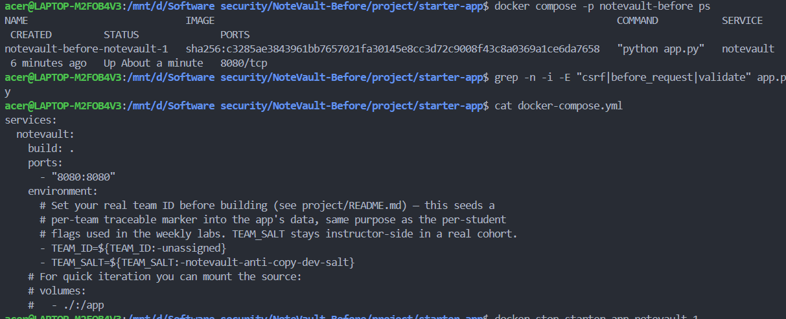

## 2. System Scope & Function

In scope are the Flask process, SQLite database, HTML templates, JSON API, Docker
image, Compose configuration, requirements, tests, and CI workflows under
`project/starter-app`. The only external entity is a local browser/API client.

### DFD and trust boundaries

```text
[Local browser/API client]
        | HTTP :8080 (TB1: network/input boundary)
        v
[Flask routes: auth, notes, search, admin, export]
        | parameterized SQL (TB2: application/data boundary)
        v
[SQLite /tmp/notevault.db] ---> [note and account records]
        ^
[Environment: APP_SECRET, TEAM_ID, TEAM_SALT]
```

Assets are credentials, JWT/session cookies, note contents, admin role, database
records, team marker, image provenance, and dependency integrity. Entry points are
`/`, `/register`, `/login`, `/logout`, `/notes`, `/api/notes/<id>`, `/search`,
`/admin`, and `/export`.

## 3. Threat Model — STRIDE

| Element / flow | S | T | R | I | D | E | Top threat & mitigation |
|---|---|---|---|---|---|---|---|
| Browser to auth routes | spoofing | tampering | repudiation | information disclosure | denial | elevation | stolen/forged session; strict HS256, HttpOnly cookie, CSRF |
| Browser to notes/search | spoofing | tampering | repudiation | disclosure | denial | elevation | SQLi/XSS/IDOR; parameters, autoescape, owner predicate |
| Browser to admin/export | spoofing | tampering | repudiation | disclosure | denial | elevation | admin data/command injection; role check, allow-list, no hashes |
| Flask to SQLite | spoofing | tampering | repudiation | disclosure | denial | elevation | injection and overbroad queries; bound parameters and least data |
| Build/dependency supply chain | spoofing | tampering | repudiation | disclosure | denial | elevation | dependency/image compromise; pinned dependencies, SBOM, SCA, attestations |

Top risks ranked by likelihood × impact: (1) SQL injection — High/High; (2) broken
object authorization — Medium/High; (3) command injection — Medium/Critical;
(4) stored XSS — Medium/High; (5) weak authentication/session and password
handling — Medium/High.

## 4. Vulnerability Findings

The following are confirmed baseline findings from source inspection and safe local
reproduction. Line numbers refer to the baseline commit `99cdb1c`.

### Finding F-01 — SQL injection in login

| Field | Value |
|---|---|
| CWE | CWE-89 |
| OWASP 2025 | A05 Injection |
| Severity | High |
| Location | `app.py` baseline login query |
| Reproduction | POST `/login` with `username=admin' --` and an invalid password. |
| Impact | Authentication bypass/data access in the vulnerable build. |
| Evidence | Baseline query interpolated username into SQL; regression now returns 401. |
| Root cause | String formatting instead of bound parameters. |
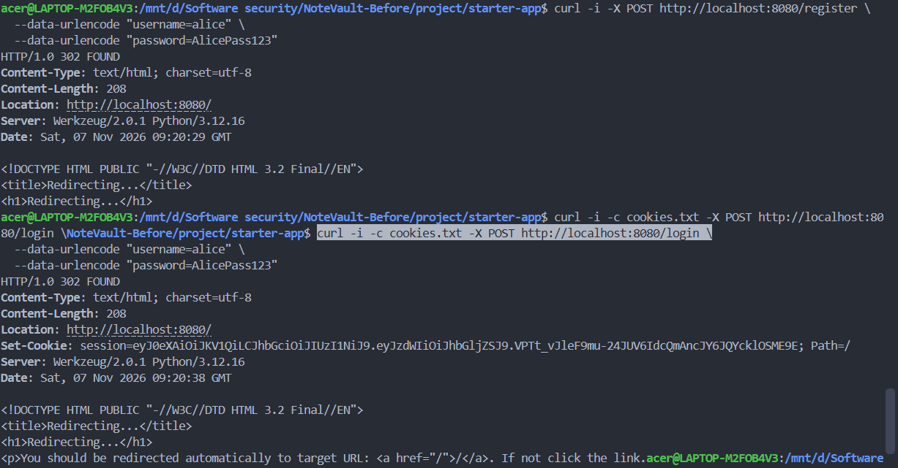

### Finding F-02 — SQL injection in search

| Field | Value |
|---|---|
| CWE | CWE-89 |
| OWASP 2025 | A05 Injection |
| Severity | High |
| Location | `app.py` baseline `/search` |
| Reproduction | Authenticated request `/search?q=' OR 1=1 --`. |
| Impact | Cross-user note disclosure and query manipulation. |
| Root cause | User and search term were concatenated into SQL. |
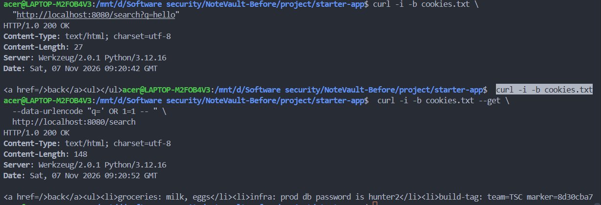
### Finding F-03 — Stored/reflected XSS

| Field | Value |
|---|---|
| CWE | CWE-79 |
| OWASP 2025 | A07 Cross-Site Scripting |
| Severity | High |
| Location | Baseline home and search rendering |
| Reproduction | Add `` as a note body. |
| Impact | Script execution in another user's browser and session actions. |
| Root cause | Raw HTML construction and `|safe`; search had unescaped interpolation. |
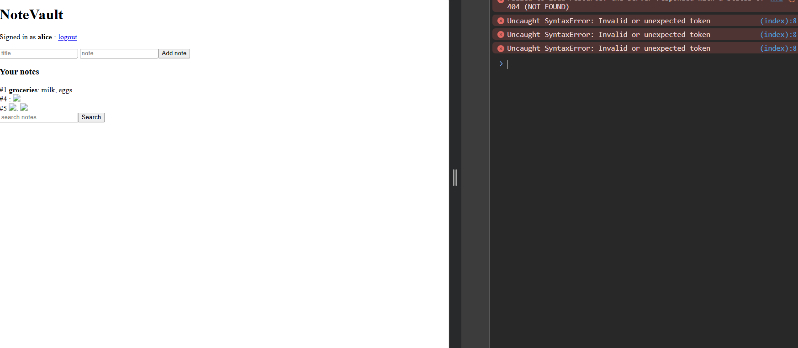
### Finding F-04 — Broken object-level authorization (IDOR)

| Field | Value |
|---|---|
| CWE | CWE-862 |
| OWASP 2025 | API1 Broken Object Level Authorization |
| Severity | High |
| Location | Baseline `/api/notes/<nid>` |
| Reproduction | Authenticate as `alice`; GET `/api/notes/2`. |
| Impact | Read another user's note, including the seeded admin note. |
| Root cause | Query checked only note ID, not owner. |
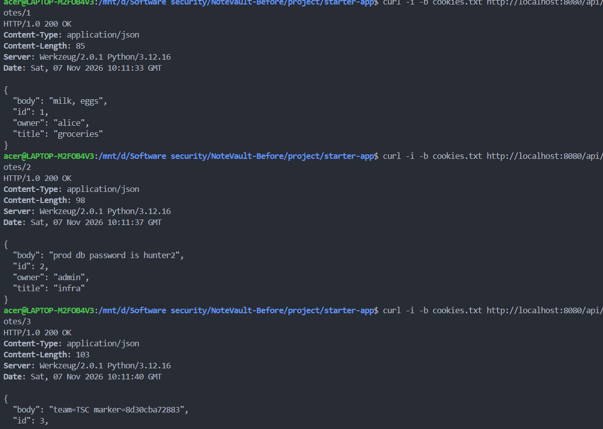
### Finding F-05 — Self-service role escalation

| Field | Value |
|---|---|
| CWE | CWE-269 |
| OWASP 2025 | A01 Broken Access Control |
| Severity | Critical |
| Location | Baseline `/register` |
| Reproduction | POST registration with `role=admin`. |
| Impact | New account gains admin access to all users. |
| Root cause | Client-controlled role was inserted into the database. |
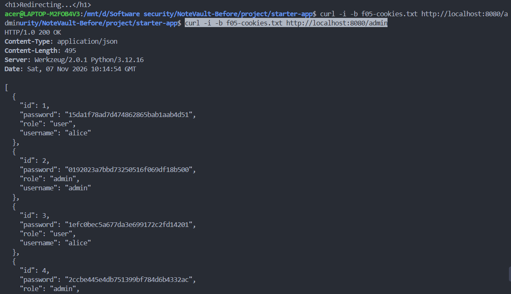
### Finding F-06 — Command injection in export

| Field | Value |
|---|---|
| CWE | CWE-78 |
| OWASP 2025 | A05 Injection |
| Severity | Critical |
| Location | Baseline `/export?fmt=...` |
| Reproduction | Authenticated request `fmt=txt;cat /etc/passwd`. |
| Impact | OS command execution as the container process. |
| Root cause | `shell=True` with concatenated user input. |
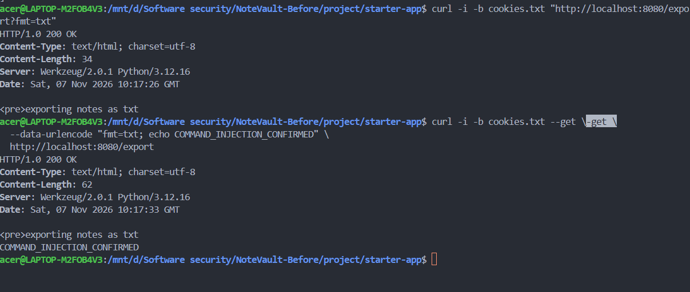
### Finding F-07 — Password hash disclosure and weak authentication storage

| Field | Value |
|---|---|
| CWE | CWE-200, CWE-916 |
| OWASP 2025 | A04 Cryptographic Failures; A01 Broken Access Control |
| Severity | High |
| Location | Baseline `/admin` and MD5 seed/registration |
| Reproduction | Authenticate as admin and GET `/admin`. |
| Impact | Hash cracking and account takeover; admin endpoint exposed hashes. |
| Root cause | MD5 storage and returning the password column. |
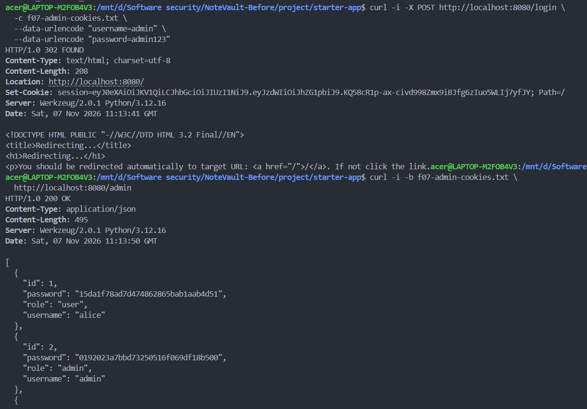
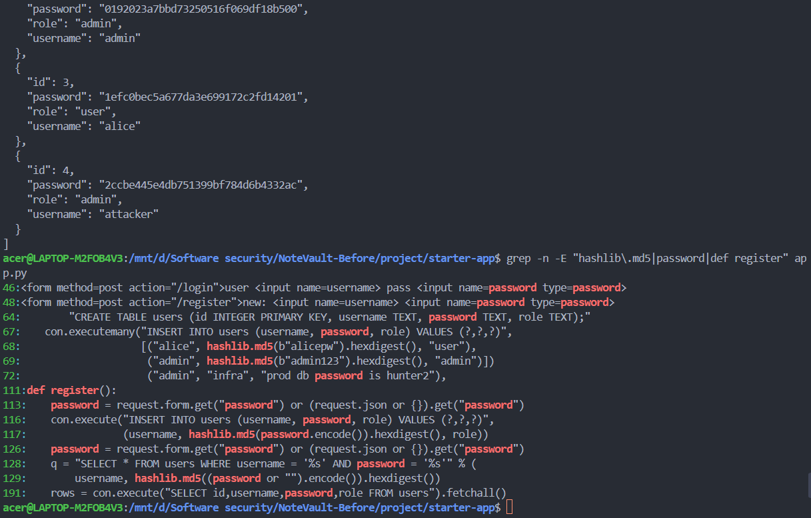
### Finding F-08 — Insecure session, CSRF, and baked secret defaults

| Field | Value |
|---|---|
| CWE | CWE-384, CWE-352, CWE-798 |
| OWASP 2025 | A07; A02 Cryptographic Failures |
| Severity | High |
| Location | Baseline JWT decode/cookie and Dockerfile |
| Reproduction | Observe `algorithms=["HS256", "none"]`, non-HttpOnly cookie, state-changing GET logout, and `APP_SECRET` in image. |
| Impact | Token confusion/forgery risk, CSRF state changes, secret exposure. |
| Root cause | Unsafe algorithm allow-list, cookie defaults, no CSRF control, baked secret. |
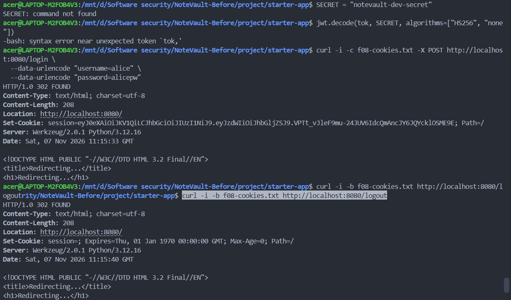
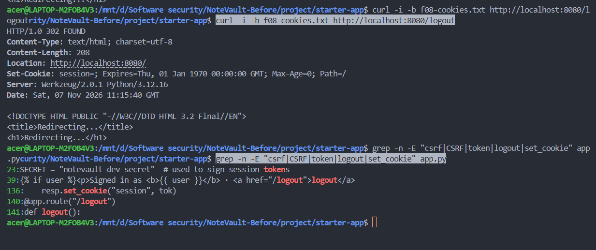
### Finding F-09 — Vulnerable dependencies and root container

| Field | Value |
|---|---|
| CWE | CWE-1104, CWE-250 |
| OWASP 2025 | A03 Software Supply Chain Failures |
| Severity | High |
| Location | Baseline requirements and Dockerfile |
| Reproduction | `pip-audit` against baseline pins and inspect Dockerfile. |
| Impact | Known dependency vulnerabilities and unnecessary container privilege. |
| Root cause | Old pins, unpinned base, root user, and secret in image. |
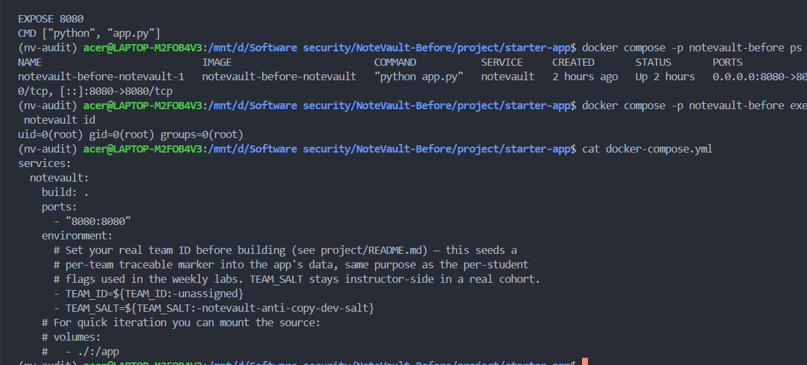
## 5. Remediation

F-01/F-02 use bound SQL parameters; F-03 uses Jinja autoescaping; F-04 adds
`owner = ?`; F-05 ignores submitted roles; F-06 removes shell execution and
allow-lists `txt`/`json`; F-07 removes password fields from admin output and uses
Werkzeug's password KDF for the starter's compatibility data; F-08 requires CSRF, strict HS256,
HttpOnly/SameSite cookies, POST logout, and runtime `APP_SECRET`; F-09 upgrades
dependencies, generates an SBOM, uses a non-root slim image, and adds CI gates.

### Before / After Fix

The following comparisons show the vulnerable baseline from commit `99cdb1c` and
the corresponding remediation in the current build.

#### F-01/F-02 — SQL injection

```diff
- q = "SELECT * FROM users WHERE username = '%s' AND password = '%s'" % (
-     username, hashlib.md5((password or "").encode()).hexdigest())
- row = con.execute(q).fetchone()
+ row = con.execute("SELECT * FROM users WHERE username = ?", (username,)).fetchone()
+ if not row or not check_password_hash(row["password"], password):
+     return "login failed", 401
```

```diff
- q = "SELECT id,title,body FROM notes WHERE owner='%s' AND body LIKE '%%%s%%'" % (user, term)
- rows = con.execute(q).fetchall()
+ rows = con.execute(
+     "SELECT id,title,body FROM notes WHERE owner = ? AND body LIKE ?",
+     (user, "%" + term + "%"),
+ ).fetchall()
```

#### F-03 — XSS

```diff
- <h3>Your notes</h3>{{ notes_html|safe }}
- notes_html = "".join("<li>...%s...</li>" % r["body"] for r in rows)
+ <h3>Your notes</h3><ul>
+ <li>#{{ row['id'] }} <b>{{ row['title'] }}</b>: {{ row['body'] }}</li>
+ </ul>
```

Jinja now escapes note content instead of inserting attacker-controlled HTML.

#### F-04 — IDOR / broken object authorization

```diff
- SELECT id,owner,title,body FROM notes WHERE id = ?
+ SELECT id,owner,title,body FROM notes WHERE id = ? AND owner = ?
```

The API now returns `404` for another user's note rather than disclosing it.

#### F-05 — Privilege escalation

```diff
- role = request.form.get("role") or ... or "user"
- INSERT INTO users (..., role) VALUES (..., role)
+ INSERT INTO users (username, password, role) VALUES (?,?,?)
+ (username, generate_password_hash(password), "user")
```

The server ignores a submitted `role=admin`; only the server assigns roles.

#### F-06 — Command injection

```diff
- subprocess.run("echo exporting notes as " + fmt, shell=True, ...)
+ if fmt not in {"txt", "json"}:
+     return "unsupported format", 400
+ rows = con.execute(
+     "SELECT id,title,body FROM notes WHERE owner = ?", (current_user(),)
+ ).fetchall()
```

The shell call was removed entirely and export output is limited to the
authenticated user's notes and two allow-listed formats.

#### F-07 — Password disclosure and weak hashing

```diff
- SELECT id,username,password,role FROM users
+ SELECT id,username,role FROM users
```

```diff
- hashlib.md5(password.encode()).hexdigest()
+ generate_password_hash(password)
...
- password = hashlib.md5(...).hexdigest()
+ check_password_hash(row["password"], password)
```

Password hashes are no longer returned by `/admin`, and passwords use Werkzeug's
salted password KDF rather than MD5.

#### F-08 — Session, CSRF, and secret handling

```diff
- jwt.decode(tok, SECRET, algorithms=["HS256", "none"])
- resp.set_cookie("session", tok)
+ jwt.decode(token, SECRET, algorithms=["HS256"])
+ response.set_cookie("session", token, httponly=True, samesite="Lax")
```

```diff
- @app.route("/logout")
+ @app.route("/logout", methods=["POST"])
+ @authenticated
+ def logout():
+     require_csrf()
```

`APP_SECRET` is now supplied at runtime; it is not baked into the image. All
state-changing routes require a CSRF token bound to the session.

#### F-09 — Dependencies and container

```diff
- FROM python:3.12
- ENV APP_SECRET=notevault-dev-secret
- RUN pip install -r requirements.txt
+ FROM python:3.12.8-slim-bookworm
+ RUN pip install --no-cache-dir --requirement requirements.txt
+ RUN addgroup --system app && adduser --system --ingroup app app
+ USER app
```

Dependency pins were upgraded and validated with `pip-audit`; the final result was
`No known vulnerabilities found`. The final image runs as UID 100 (`app`).

Regression proof is `7 passed` in `test_app.py`. Separate finding commits should be
created from the coherent changes below before submission if the instructor
requires one commit per finding; this working tree preserves unrelated existing
student changes.

## 6. Supply-Chain Hardening

`sbom.json` is CycloneDX 1.6 with 6 runtime components, generated with:

```powershell
cyclonedx-py requirements requirements.txt --output-format json --output-file sbom.json
pip-audit -r requirements.txt
```

The verified local SCA result was **No known vulnerabilities found** after upgrading
the pins. Cosign signing is configured in `.github/workflows/release.yml`, but no
signature is claimed here: it requires a pushed registry digest and authorized OIDC
credentials. The same workflow requests GitHub artifact attestations. This is a
SLSA-style provenance configuration, not a locally verified SLSA level.

## 7. Security CI Pipeline

`.github/workflows/security.yml` runs pytest, `pip-audit --strict`, Semgrep Flask/
Python rules, and Gitleaks. A nonzero scanner result fails the job. The workflow
uses read-only contents permission; release signing separately requests only the
OIDC, attestation, package, and contents permissions it needs. GitHub Actions has
not been run in this local session, so no CI pass/fail claim or screenshot is made.

## 8. Conclusion & Reflection

The fixed local build materially reduces injection, authorization, XSS, session,
and supply-chain risk. Residual risks include no password migration path for
accounts outside this starter database, ephemeral SQLite storage, lack of rate limiting, no
centralized audit logging, and manual registry/OIDC release setup. Next hardening
would add Argon2id migration, rate limiting, encrypted persistent storage, and
independent image vulnerability scanning.

## Appendix

Tools: Python, pytest, Docker Compose, CycloneDX, pip-audit, Semgrep/Gitleaks in CI,
Cosign and GitHub attestations in the release workflow. Testing remained local and
within the authorized NoteVault scope described by `ETHICS.md`.
